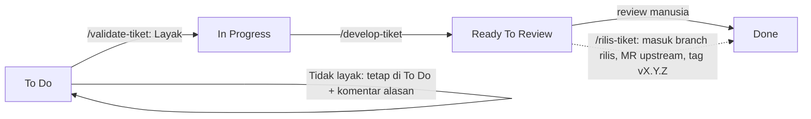
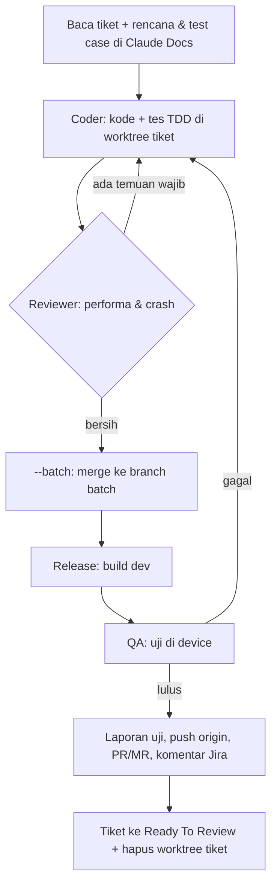

# agent-workflow

Tim agen Claude Code + Orca untuk mengerjakan tiket Jira di proyek mobile (native iOS/Android, KMP): dari cek tiket, menulis kode, uji di device, build, sampai PR/MR dan rilis. Dilengkapi pagar keamanan (`guard.sh`) dan pembersihan disk otomatis.

Status: **v1 terpasang**, siap uji coba di tiket nyata.

## Daftar isi
1. [Mulai cepat](#mulai-cepat)
2. [Istilah penting](#istilah-penting)
3. [Alur kerja + papan kanban](#alur-kerja)
4. [Tim agen](#tim-agen)
5. [Pagar keamanan](#pagar-keamanan)
6. [Alat (tools) + MCP](#alat-tools)
7. [Pasang di komputer lain](#pasang-di-komputer-lain-macos)
8. [Isi repo](#isi-repo)
9. [Masalah umum](#masalah-umum)
10. [Merawat dokumen ini](#merawat-dokumen-ini)

## Mulai cepat

Ketik perintah ini di Claude Code, di dalam terminal Orca:

| Perintah | Gunanya | Jalankan dari |
| --- | --- | --- |
| `/validate-tiket KODE...` | Cek tiket layak dikerjakan; bug direproduksi di device. Hasil: laporan bergambar + komentar Jira | mana saja |
| `/develop-tiket KODE... [--solo\|--tim] [--batch\|--separate]` | Rencana, kode (TDD), review, uji di device, build, PR/MR, komentar Jira, tiket ke Ready To Review | workspace domain |
| `/rilis-tiket KODE-RILIS` atau `/rilis-tiket baru release\|hotfix` | Kumpulkan tiket ke branch rilis/hotfix, cek manifest, build beta, satu MR ke upstream | root project atau domain |
| `/audit-issue "teks" [--solo\|--tim] [lampiran...]` | Telusuri keluhan yang belum jadi tiket, **hanya-baca**. Hasil: laporan + saran tiket | mana saja |

Contoh:
```text
/validate-tiket PROJ-1234
/develop-tiket PROJ-1234 PROJ-1240 --tim
/develop-tiket PROJ-1300 --solo --separate
/audit-issue "chat tidak muncul notifikasi di iOS 18" --solo
```

Pilihan `/develop-tiket`:

| Flag | Artinya |
| --- | --- |
| `--solo` | Satu agen mengerjakan semuanya |
| `--tim` | SPV membagi kerja ke Coder, Reviewer, QA, Release sebagai teammate (tiap agen panel sendiri) |
| (tanpa `--solo/--tim`) | SPV memilih: satu tiket kecil = solo, selain itu tim |
| `--batch` (default) | Semua tiket digabung: satu rencana, **satu build**, QA bersama di build itu. Proses berat jalan sekali untuk semua tiket |
| `--separate` | Tiap tiket jalan sendiri: rencana, build, QA, laporan masing-masing |

## Istilah penting

| Istilah | Penjelasan sederhana |
| --- | --- |
| **SPV** | Agen "mandor": membaca tiket, membagi tugas, memutuskan tiket selesai |
| **Workspace domain** | Workspace Orca yang kamu buka untuk kerja kode (mis. "Manager", "BAA"). Root project hanya untuk audit, tanya, dan rilis |
| **Worktree tiket** | Salinan kerja repo khusus satu tiket, folder `<repo>-<nomor>` di sebelah checkout domain. Dihapus otomatis setelah Ready To Review bila bersih dan sudah di-push |
| **Branch batch** | Branch lokal tempat semua tiket `--batch` digabung untuk satu build. Tidak pernah di-push |
| **Titik tunggu** | Di `--batch`, build dan QA ulang menunggu semua tiket siap, lalu jalan sekali |
| **Guard** | Hook yang memblokir perintah berbahaya sebelum dijalankan |
| **Claude Docs** | Tempat laporan bergambar; link-nya ditaruh di baris pertama komentar Jira |
| **Downstream / upstream** | `origin` = fork kita (boleh push branch); `upstream` = repo utama (hanya lewat MR) |
| **TC / AC** | Test case / acceptance criteria tiket. Hasil TC: Lulus, Gagal, atau Tertahan (dengan alasan) |

## Alur kerja

### Papan kanban Jira
Setiap tiket bergerak dari kiri ke kanan. Satu kolom = satu status tiket.

| | To Do | In Progress | Ready To Review | Done |
| --- | --- | --- | --- | --- |
| **Artinya** | Tiket baru, belum dicek | Layak dan sedang dikerjakan | Kode + uji selesai, menunggu review manusia | Diterima dan selesai |
| **Perintah di kolom ini** | `/validate-tiket` | `/develop-tiket` | `/rilis-tiket` (kumpulkan ke rilis) | — |
| **Pindah oleh** | — | agen (Validator), bila **Layak** | agen (Release), bila semua TC Lulus/Tertahan beralasan | **manusia saja** |
| **Bukti yang ditinggalkan** | — | laporan validasi + komentar Jira | rencana, laporan uji, build dev, PR/MR, komentar Jira | — |



- Agen **tidak pernah** memindah tiket ke Done; guard memblokirnya karena Done tidak ada di `jira-transitions.json`.
- Agen hanya boleh memakai dua transisi: **In Progress** dan **Ready To Review**. ID-nya dipilih kamu sekali per project.
- Tiket yang gagal review manusia dikembalikan ke In Progress oleh manusia, lalu `/develop-tiket` dijalankan lagi.

### `/validate-tiket`
1. Baca tiket, komentar, dan link terkait; catat AC dan versi.
2. **Bug:** pasang versi yang disebut tiket (kosong = build dev/beta terbaru), reproduksi di device, screenshot tiap langkah dengan kotak merah.
   **Fitur:** cek requirement lengkap, spec API ada di repo, desain tersedia.
3. Laporan di Claude Docs, lalu komentar Jira: **Layak** / **Layak dengan catatan** / **Tidak layak**.
4. Layak → tiket ke In Progress. Tidak layak → tetap Todo.

### `/develop-tiket`

- Di `--batch`, build baru jalan setelah **semua** tiket lolos review (atau dikeluarkan dari batch dengan alasan tertulis). Perbaikan setelah QA dikumpulkan dulu, baru satu build ulang.
- Tiket yang macet dikeluarkan dari batch dan dilaporkan, tidak dijalankan sendiri diam-diam.

### `/rilis-tiket`
1. Baca tiket rilis (`[release-request]` / `[hotfix-release]`) dan manifest tiketnya.
2. Cek kondisi repo (branch, tag, versi live), lalu **selalu tanya** sebelum membuat `release/vX.Y.Z` atau `hotfix/vX.Y.Z` di downstream.
3. MR per tiket ke branch itu, `manifest-check.sh` memastikan isi branch = manifest.
4. Build beta (nomor build dari `build-number.sh`; ragu → tanya), satu MR ke upstream, komentar tiket rilis.
5. Setelah MR upstream di-merge: tag `vX.Y.Z` di-push ke `upstream` dan `origin`.

### `/audit-issue`
1. Langsung membuat dokumen laporan di Claude Docs, lalu memecah keluhan jadi pertanyaan.
2. Auditor menelusuri kode, riwayat git, log, dan reproduksi di device memakai build yang **sudah ada**; Analis membandingkan lampiran (mockup/PDF/gambar) dengan aplikasi.
3. Kesimpulan dengan tingkat keyakinan (**pasti / kuat / dugaan**) + saran tiket Jira (tidak dibuat otomatis).
4. Selama audit, guard memblokir semua penulisan ke repo, git remote, dan Jira.

Detail lengkap tiap langkah: `skills/<perintah>/SKILL.md`. Aturan bersama: [skills/_shared/rules.md](skills/_shared/rules.md).

## Tim agen

| Agen | Nama | Model | Tugas | Tidak boleh |
| --- | --- | --- | --- | --- |
| SPV | Pak Darmo | opus | bagi tugas, jatah device, putuskan selesai, publikasi laporan | menulis kode produk |
| Validator | Kang Jajang | opus | `/validate-tiket` | menulis kode produk |
| Coder | Maman, Ujang, Tarjo, Asep, Parmin | sonnet | kode + tes (TDD) di branch tiket | Jira, push, upload |
| Reviewer | Mbah Karto | opus | review performa & risiko crash | review kode sendiri |
| QA | Paijo, Euis, Ningsih | sonnet | uji di device (Maestro, XCUITest), API (Schemathesis), kontrak (Pact) | Jira, push, upload |
| Release | Sutini | haiku | nomor build, build + upload, push, PR/MR, komentar & geser tiket | Done, upload prod tanpa izin |
| Auditor | Cecep, Dadang, Sarip | opus | `/audit-issue`: kode, log, reproduksi | menulis repo/Jira |
| Analis | Bu Lastri | opus | `/audit-issue`: lampiran | menulis repo/Jira |

Di mode tim, tiap agen adalah **teammate** Claude Code (fitur *agent teams*). Orca menampilkannya sebagai **panel split** di workspace yang sama (bukan tab baru), dengan label seperti `@Maman-Programmer1` tepat di atas kolom input panel itu. Panel muncul sendiri saat SPV memanggil agen, dan tertutup sendiri saat agen dihentikan. Agen yang dapat tugas lanjutan dikirimi pesan, tidak dipanggil dua kali. Model tiap peran diubah di `agents/<peran>.md`.

> **Syarat mode tim:** sesi utama harus jalan dengan teammate mode. Pilih salah satu: jalankan `claude --teammate-mode auto`, atau sekali saja di Claude Code ketik `/config` → **Teammate mode** → `auto`. Tanpa itu agen bertanya: buka ulang sesi, atau lanjut solo.

## Pagar keamanan

**Selalu diblokir oleh guard** (juga di mode otonom):
- Push branch ke selain `origin`; force-push atau hapus `main`/`master`/`develop`. Pengecualian: tag `vX.Y.Z` eksplisit boleh ke `origin` dan `upstream`.
- `rm -r` di luar folder project.
- Memindah tiket ke status di luar `~/.agent-workflow/jira-transitions.json` (Done tidak pernah ada di sana).
- Edit file di worktree primary; membuka tab/workspace/project Orca baru; worktree di luar folder project.
- Mode audit: semua penulisan ke repo, git remote, dan Jira.

**Agen selalu berhenti dan bertanya** bila: upload ke prod, akan membuat branch rilis/hotfix, nomor build tidak jelas, kredensial tidak ditemukan, dua fix hotfix bentrok, atau `build:heavy` sedang dipakai tiket Jira lain (kamu memilih: tunggu, atau dahulukan tugas ini).

**Kredensial** dibaca dari file lokal (mis. `qa.local.properties`) dan tidak pernah ditulis ke Docs, Jira, atau MR. Data uji hanya di dev/staging, diawali kode tiket (mis. `PROJ-1234-user`).

## Alat (tools)

### Skrip di `bin/`
Agen memanggilnya sebagai `$AGENT_WORKFLOW_DIR/bin/<skrip>`. Kamu juga boleh menjalankannya manual.

| Skrip | Gunanya | Contoh |
| --- | --- | --- |
| `device-pick.sh` | Ambil device bebas: virtual yang menyala → boot virtual bila belum menyala (1 per platform) → device fisik bila virtual penuh. `--physical` = hanya fisik, untuk fitur yang butuh hardware asli | `AGENT_LOCK_PID=$PPID bin/device-pick.sh ios PROJ-1234-qa1` → `ios:<udid>` |
| `device-lock.sh` | Kunci device/akun/checkout supaya satu benda dipakai satu agen | `bin/device-lock.sh who ios:<udid>` |
| `ios-ui.sh` | Jalankan langkah uji iOS lewat XCUITest runner (lihat bawah) | `bin/ios-ui.sh <udid> steps.json out/` |
| `annotate.py` | Gambar kotak merah + label di screenshot dari koordinat | `uv run --with pillow python3 bin/annotate.py in.png boxes.json out.png` |
| `build-number.sh` | Tentukan nomor build; exit 3 = sumber tidak sepakat, agen bertanya | `bin/build-number.sh next asc=41 firebase=41 tag=40` |
| `manifest-check.sh` | Bandingkan tiket di commit branch rilis dengan manifest | `bin/manifest-check.sh origin/master origin/release/v1.2.0 PROJ-1 PROJ-2` |
| `build-preempt.sh` | Saat `build:heavy` dipakai tiket lain: `info` (siapa, berapa lama, sedang upload?), `take` (hentikan build itu dan ambil kunci, setelah kamu setuju), `check` (agen yang dihentikan tahu harus build ulang) | `bin/build-preempt.sh info` |
| `audit-mode.sh` | Nyalakan/matikan mode hanya-baca untuk `/audit-issue` | `AGENT_LOCK_PID=$PPID bin/audit-mode.sh status` |
| `housekeeping.sh` | Bersihkan cache build tiap jam (dijalankan launchd, lihat bawah) | otomatis |

Setiap kunci memakai `AGENT_LOCK_PID=$PPID` di perintah yang sama; kunci milik proses yang sudah mati otomatis dianggap bebas.

### Alat device: pilih yang mana?

| Kebutuhan | Android | iOS |
| --- | --- | --- |
| Alur pengguna (E2E, login, chat, regresi, visual dasar) | Maestro | Maestro |
| Maestro terkendala (driver gagal, timeout, elemen tidak terbaca) | Android CLI (`android`) → `adb` | XCUITest runner (`ios-ui.sh`) |
| Inspeksi UI native, screenshot satu elemen, alert sistem, tekan lama | Android CLI (`android layout`, `android input`) | XCUITest runner, langsung tanpa menunggu Maestro gagal |
| Metrik UI (waktu buka app, kelancaran scroll) | — | XCUITest runner `measure` |
| Posisi elemen untuk kotak merah | `maestro hierarchy` atau `android layout` | `maestro hierarchy` atau `<nama>-frames.json` dari XCUITest |
| Build | `./gradlew` (flavor project) | `xcodebuild` |

Urutan cadangan: coba Maestro sekali lagi setelah app di-restart → alat cadangan → kalau tetap gagal, TC ditandai **Tertahan** dengan alat yang dicoba dan error-nya.

### Virtual atau fisik?
**Virtual dulu** (simulator/emulator): lebih cepat dan device fisik tetap bebas. Tiap platform punya **1 virtual + 1 fisik**, jadi paling banyak 2 agen per platform memakai device bersamaan. Virtual penuh → otomatis pindah ke device fisik.

Langsung **device fisik** (`--physical`) bila yang diuji butuh hardware asli: push notification APNs, kamera/scan QR, NFC, Bluetooth, sensor/GPS bergerak, SMS/telepon asli, biometrik/pembayaran, metrik performa, atau bug di model device tertentu. TC seperti ini ditandai `(fisik)` di rencana. Daftar lengkap: "Kapan wajib device fisik" di [skills/_shared/devices.md](skills/_shared/devices.md).

### XCUITest runner (iOS)
Proyek Xcode kecil di `ios-runner/` yang mengendalikan app apa pun lewat bundle id, jadi repo app tidak disentuh. Dibangun otomatis sekali (± 30 detik), lalu dipakai ulang.

```bash
cat > steps.json <<'X'
[{"launch":"com.app.dev"},
 {"type":"PROJ-1234-user","into":{"id":"phone"}},
 {"tap":{"label":"Masuk"}},
 {"alert":"Allow"},
 {"screenshot":"TC1-01"},
 {"hierarchy":"TC1-02"},
 {"elementShot":"TC1-03","of":{"id":"btnSave"}}]
X
bin/ios-ui.sh <udid> steps.json /tmp/qa/PROJ-1234/xcui-1
```
- Hasil: `TC1-01.png`, `TC1-02.txt` (pohon UI), `TC1-02-frames.json` (posisi elemen dalam piksel), `TC1-03.png`, `metrics/*.csv` (bila ada `measure`). Langkah gagal → exit ≠ 0 dan `fail-step<N>.png`.
- iPhone fisik butuh `IOS_TEAM` (Team ID dari project app); simulator tidak.
- Daftar aksi dan selector lengkap: bagian "Pilih alat iOS" di [skills/_shared/devices.md](skills/_shared/devices.md).

### Alat lain

| Alat | Dipakai untuk |
| --- | --- |
| Maestro | Aksi di device (tap, ketik, scroll), screenshot tiap langkah |
| Android CLI (`android`) | Cadangan Maestro di Android, pasang/jalankan APK, docs Android |
| Schemathesis | Uji API terhadap spec di repo, hanya dev/staging |
| Pact | Uji kontrak bila ada kontrak di repo |
| `gh` / `glab` | Membuat PR (GitHub) / MR (GitLab) |
| Firebase CLI / TestFlight | Upload build dev/beta; prod hanya dengan izin |
| Orca CLI | Workspace, worktree, panel teammate (lewat plugin agent view Orca) |
| Atlassian MCP / Claude Docs MCP | Baca & komentar Jira / tulis laporan |

### MCP yang dipakai
MCP = konektor yang membuat Claude bisa memakai layanan luar. Workflow ini memakai dua, keduanya dipasang sebagai konektor di claude.ai:

| MCP | Gunanya | Dipakai oleh | Fungsi yang dipanggil |
| --- | --- | --- | --- |
| **Atlassian** (Jira) | Baca tiket, komentar, pindah status, buat tiket rilis | Validator, SPV, Release, Auditor (baca saja) | `getJiraIssue`, `searchJiraIssuesUsingJql`, `addCommentToJiraIssue`, `transitionJiraIssue`, `getTransitionsForJiraIssue`, `createJiraIssue` + `createIssueLink` (tiket rilis), `atlassianUserInfo` (cek koneksi) |
| **Claude Docs** | Laporan validasi, rencana + test case, laporan uji, laporan audit (bergambar) | Validator, SPV, `/audit-issue` | `batch` (buat/isi dokumen), unggah screenshot |

Bukan bagian workflow (boleh terpasang, tidak dibutuhkan): GitHub MCP (PR dibuat lewat `gh` CLI), context7 (docs library untuk coding biasa). Guard ikut memeriksa panggilan Atlassian: transisi di luar daftar ditolak, dan di mode audit semua penulisan Jira diblokir.

### Pembersihan otomatis (`housekeeping.sh`)
Dijalankan launchd tiap jam (`com.agentworkflow.housekeeping`). Gratis, jalan walau Orca tertutup, tanpa agen Claude.

**Kapan dilewati:** hanya saat ada build yang benar-benar jalan: kunci `build:heavy` dipegang, atau proses `xcodebuild`, `gradlew`, atau upload aktif. Kunci checkout/device/akun milik sesi yang dibiarkan terbuka, dan Gradle daemon yang diam, **tidak** dihitung sibuk.
- **Harian (≥ 03.00):** DerivedData Xcode > 3 hari; APK/AAB/IPA > 7 hari di folder `~/.agent-workflow/build-roots.txt`.
- **Mingguan (Minggu ≥ 03.30):** semua DerivedData, cache Gradle/Kotlin Native lama, iOS DeviceSupport > 90 hari, simulator rusak, cache CocoaPods/brew/npm.
- **Darurat:** sisa disk < 50 GB → bersihkan harian sekarang; masih kurang → notifikasi. Saat build jalan, darurat tetap membersihkan bagian yang aman (DeviceSupport lama, simulator rusak, cache CocoaPods/brew/npm).
- **Pengingat:** pembersihan harian terlewat lebih dari sehari karena build terus berjalan → notifikasi sekali per hari.
- Log: `~/.agent-workflow/logs/housekeeping.log`. Banyak "busy, skipping" berarti ada build yang tidak selesai atau kunci `build:heavy` yang tertahan.

## Pasang di komputer lain (macOS)

1. Prasyarat:
   ```bash
   brew install jq gh glab maestro firebase-cli cocoapods uv
   uv tool install schemathesis
   brew tap pact-foundation/pact-ruby-standalone && brew install pact-legacy
   ```
   Plus: Xcode (juga untuk XCUITest runner), Android SDK (`adb`, emulator, `android`), Claude Code, Orca. Untuk mode tim: `/config` → Teammate mode → `auto` (lihat [Tim agen](#tim-agen)).
2. Plugin Claude Code: `superpowers` dan `ponytail` (lewat `/plugin`).
3. Konektor claude.ai: **Atlassian** (Jira) dan **Claude Docs**.
4. Login CLI: `gh auth login`, `glab auth login`, `firebase login`.
5. Pasang dan cek:
   ```bash
   git clone https://github.com/roiskhoiron/agent-workflow ~/agent-workflow
   bash ~/agent-workflow/install.sh && bash ~/agent-workflow/tests/run.sh   # harus "ALL PASS"
   ```
   Installer membuat symlink skill & agen ke `~/.claude`, memasang hook guard (backup `settings.json.bak-agent-workflow`), job launchd housekeeping, dan bagian CLAUDE.md global (sekali saja). Karena symlink, perubahan di repo langsung berlaku tanpa pasang ulang; pasang ulang hanya bila ada skill/agen/hook baru.

Tidak ikut repo (per komputer):
- `~/.agent-workflow/jira-transitions.json`: agen menanyakan ID transisi In Progress / Ready To Review saat pertama jalan di project baru.
- `~/.agent-workflow/build-roots.txt` (opsional): folder project untuk dibersihkan housekeeping.
- Kredensial `qa.local.properties` per project, kunci App Store Connect.

## Isi repo

| Folder | Isi |
| --- | --- |
| `skills/<perintah>/SKILL.md` | Langkah tiap perintah (`/validate-tiket`, `/develop-tiket`, `/rilis-tiket`, `/audit-issue`) |
| `skills/_shared/` | Aturan bersama: `rules.md` (tim, guard, git, worktree), `devices.md` (device & alat), `build-release.md`, `credentials.md`, `report-format.md` |
| `agents/` | Peran agen (model, tugas, larangan) |
| `bin/` | Skrip pembantu (tabel di atas) |
| `hooks/guard.sh` | Pagar keamanan |
| `ios-runner/` | XCUITest runner untuk iOS |
| `tests/` | Tes skrip & guard: `bash tests/run.sh` |
| `docs/` | Rancangan ([design-summary.md](docs/design-summary.md)) dan rencana implementasi |

## Masalah umum

| Gejala | Artinya / yang dilakukan |
| --- | --- |
| "DIBLOKIR oleh guard: ..." | Perintah melanggar pagar. Agen melaporkan pesannya, tidak mencari jalan memutar. Baca pesannya; biasanya menyebut cara yang benar |
| "Teammate mode mati" / agen bertanya buka ulang sesi | Mode tim butuh teammate mode. Buka ulang Claude dengan `claude --teammate-mode auto` atau set `/config` → Teammate mode → `auto`, lalu ulangi perintah |
| "Jalankan dari workspace domain" | `/develop-tiket` dijalankan dari root project. Buka workspace domain di Orca lalu ulangi |
| "belum punya daftar transisi" | Project baru: agen menunjukkan daftar status, kamu pilih ID In Progress dan Ready To Review |
| `device-pick.sh` exit 1 | Semua device sedang dipakai; agen menunggu lalu mencoba lagi |
| "build:heavy sedang dipakai PROJ-1 — … Mana yang didahulukan?" | Mac hanya kuat satu build berat sekaligus. **Tunggu** = antre. **Dahulukan** = build tiket lain dihentikan dan diulang otomatis setelah build kita selesai (lebih cepat karena cache). Upload tidak pernah dihentikan |
| `build-number.sh` exit 3 | Sumber nomor build tidak sepakat; agen bertanya dengan saran `max+1` |
| TC **Tertahan** | Tidak bisa diuji (device kurang, spec tidak ada, semua alat gagal); alasannya tertulis di laporan |

## Merawat dokumen ini

README ini adalah pintu masuk untuk pemula. **Setiap perubahan workflow atau alat wajib memperbarui README di commit yang sama**: perintah atau flag baru, skrip `bin/` baru, alat device baru, atau aturan keamanan baru. `tests/readme_test.sh` gagal bila ada perintah atau skrip `bin/` yang belum disebut di sini. Detail teknis tetap di `skills/` dan `agents/`; README cukup menjelaskan apa, kapan, dan contoh.
