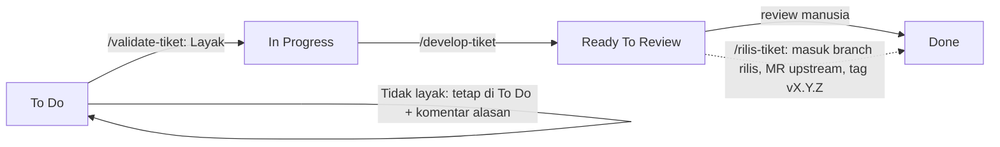
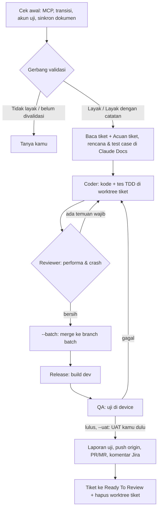

# Alur kerja

## Papan kanban Jira
Setiap tiket bergerak dari kiri ke kanan. Satu kolom = satu status tiket.

| | To Do | In Progress | Ready To Review | Done |
| --- | --- | --- | --- | --- |
| **Artinya** | Tiket baru, belum dicek | Layak dan sedang dikerjakan | Kode + uji selesai, menunggu review manusia | Diterima dan selesai |
| **Perintah di kolom ini** | `/validate-tiket` | `/develop-tiket` | `/rilis-tiket` (kumpulkan ke rilis) | — |
| **Pindah oleh** | — | agen (Validator), bila **Layak** | agen (Release), bila semua TC Lulus/Tertahan beralasan | **manusia saja** |
| **Bukti yang ditinggalkan** | — | laporan validasi + komentar Jira | rencana, laporan uji, build dev, PR/MR, komentar Jira | — |

- Agen **tidak pernah** memindah tiket ke Done; guard memblokirnya karena Done tidak ada di `jira-transitions.json`.
- Agen hanya boleh memakai dua transisi: **In Progress** dan **Ready To Review**. ID-nya dipilih kamu sekali per project.
- Tiket yang gagal review manusia dikembalikan ke In Progress oleh manusia, lalu `/develop-tiket` dijalankan lagi.

## `/validate-tiket`
1. Baca tiket, komentar, dan link terkait; catat AC dan versi.
2. **Bug:** pasang versi yang disebut tiket (kosong = build dev/beta terbaru), reproduksi di device, screenshot tiap langkah dengan kotak merah.
   **Fitur:** cek requirement lengkap, spec API ada di repo, desain tersedia.
3. Laporan di Claude Docs, lalu komentar Jira: **Layak** / **Layak dengan catatan** / **Tidak layak**.
4. Layak → tiket ke In Progress. Tidak layak → tetap Todo.

**Mode tim (`--tim`):** Validator jadi SPV. Sekali per sesi ia mengambil dokumen terbaru (business discovery, mockup, kontrak API, blueprint; lokasinya per project disimpan di memory project) dan menjalankan `graphify update`. Lalu paralel: **PdM** membaca dokumen bisnis, **Product Designer** mengecek mockup dan mereproduksi bug UI, **Contract Runner** menjalankan Schemathesis/Pact, **HoE** mencocokkan codebase dengan blueprint dan mereproduksi bug logika, **PjM** memantau tiket terkait dan PR terbuka. **Spesialis eskalasi** (Fable 5.2) hanya dipanggil saat ada pemicu: bug logika gagal direproduksi, temuan ambigu, tiket high-risk, atau konflik antar-agen. Semua hanya-baca; Validator menulis satu laporan, komentar Jira, dan transisi. Tiket UI tanpa mockup paling tinggi **Layak dengan catatan**.

**Tiket terkait dan requirement bermasalah (solo dan tim):** selain tiket yang sudah di-link, Validator (mode tim: PjM) mencari tiket Todo/In Progress yang tidak di-link tapi menyentuh komponen, label, layar, fitur, atau endpoint yang sama, lalu menilai selaras atau bertabrakan. Link antar tiket tidak dibuat agen, hanya disarankan di komentar.

| Kondisi | Keputusan | Tindakan |
| --- | --- | --- |
| Informasi minim, AC inti jelas | Layak dengan catatan | Pertanyaan di komentar Jira untuk reporter |
| Informasi minim, AC inti kabur | Tidak layak | Tetap Todo; komentar berisi daftar yang harus dilengkapi |
| Bertabrakan dengan tiket/dokumen lain | Tidak layak sampai diputuskan | Komentar menyebut kedua tiket + titik tabrakan; kamu memilih mana yang berlaku |
| Tumpang tindih tapi selaras | Layak dengan catatan | Saran urutan pengerjaan atau penggabungan |

## `/develop-tiket`
Pilihan `/develop-tiket`:

| Flag | Artinya |
| --- | --- |
| `--solo` | Satu agen mengerjakan semuanya |
| `--tim` | Planner menulis rencana + test case, lalu SPV membagi kerja ke Coder, Reviewer, QA, Release sebagai teammate (tiap agen panel sendiri) |
| (tanpa `--solo/--tim`) | SPV memilih: satu tiket kecil = solo, selain itu tim |
| `--batch` (default) | Semua tiket digabung: satu rencana, **satu build**, QA bersama di build itu. Proses berat jalan sekali untuk semua tiket |
| `--separate` | Tiap tiket jalan sendiri: rencana, build, QA, laporan masing-masing |
| `--uat` | Sesudah QA lulus, kamu menguji sendiri build dev di HP fisik; SPV memantau log app dan melaporkan crash. Selesai saat kamu bilang "selesai UAT" atau 3 menit tanpa log |

- **Sebelum mulai**, SPV menyinkronkan dokumen (business discovery, mockup, kontrak API, blueprint; sama seperti `/validate-tiket`) dan membaca laporan validasi terakhir:

  | Laporan validasi | Tindakan |
  | --- | --- |
  | Belum ada | SPV bertanya: validasi dulu, atau lanjut dengan cek singkat |
  | Tidak layak | Berhenti dan bertanya |
  | Layak dengan catatan | Catatan masuk rencana dan test case |
  | Layak | Lanjut |

  Dokumen yang berubah sejak validasi dan menyentuh AC, desain, atau kontrak → SPV menyebut perbedaannya dan bertanya. Link dokumen terbaru (**Acuan tiket**) dibawa ke rencana, Coder, dan QA.
- **Basecode:** agen menyimpan dua branch per repo di memory project: **primary** (produksi/live) dan **protected** (integrasi). Belum ada → agen bertanya sekali. Tiket bercabang dari versi **terbaru di remote** (SPV `git fetch` dulu): hotfix dari `upstream/<primary>` (atau tag live), feature request/fix dari `upstream/<protected>`, atau `origin/release/...`/`origin/hotfix/...` bila branch rilis tiketnya sudah ada. Base + hash commit dicatat di rencana. Worktree tiket lama yang tertinggal dari base → SPV bertanya rebase/merge atau lanjut.
- Di `--batch`, build baru jalan setelah **semua** tiket lolos review (atau dikeluarkan dari batch dengan alasan tertulis). Perbaikan setelah QA dikumpulkan dulu, baru satu build ulang.
- Tiket yang macet dikeluarkan dari batch dan dilaporkan, tidak dijalankan sendiri diam-diam.
- Dengan `--uat`, device fisik dipindah ke kamu (kunci `human-<KODE>`); crash selama UAT mengembalikan tiket ke Coder. Pemantauan log gagal → SPV memberi tahu, dan hasil UAT mengikuti laporanmu.

## `/rilis-tiket`
1. Baca tiket rilis (`[release-request]` / `[hotfix-release]`) dan manifest tiketnya.
2. Cek kondisi repo (branch, tag, versi live), lalu **selalu tanya** sebelum membuat `release/vX.Y.Z` atau `hotfix/vX.Y.Z` di downstream.
3. MR per tiket ke branch itu, `manifest-check.sh` memastikan isi branch = manifest.
4. Build beta (nomor build dari `build-number.sh`; ragu → tanya), satu MR ke upstream, komentar tiket rilis.
5. Setelah MR upstream di-merge: tag `vX.Y.Z` di-push ke `upstream` dan `origin`.

## `/audit-issue`
1. Langsung membuat dokumen laporan di Claude Docs, lalu memecah keluhan jadi pertanyaan.
2. Auditor menelusuri kode, riwayat git, log, dan reproduksi di device memakai build yang **sudah ada**; Analis membandingkan lampiran (mockup/PDF/gambar) dengan aplikasi.
3. Kesimpulan dengan tingkat keyakinan (**pasti / kuat / dugaan**) + saran tiket Jira (tidak dibuat otomatis).
4. Selama audit, guard memblokir semua penulisan ke repo, git remote, dan Jira.

Detail lengkap tiap langkah: `skills/<perintah>/SKILL.md`. Aturan bersama: [skills/_shared/rules.md](../skills/_shared/rules.md).

---
[← kembali ke README](../README.md)
