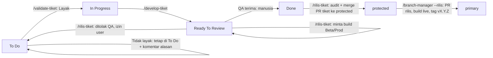
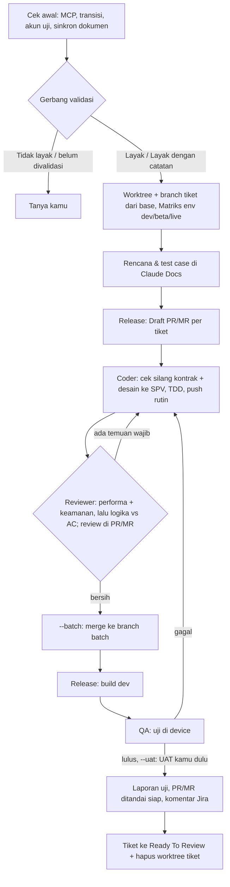

# Alur kerja

## Papan kanban Jira
Setiap tiket bergerak dari kiri ke kanan. Satu kolom = satu status tiket.

| | To Do | In Progress | Ready To Review | Done |
| --- | --- | --- | --- | --- |
| **Artinya** | Tiket baru, belum dicek | Layak dan sedang dikerjakan | Kode + uji selesai, menunggu review manusia | Diterima dan selesai |
| **Perintah di kolom ini** | `/validate-tiket` | `/develop-tiket` | `/rilis-tiket` (feedback QA) | `/rilis-tiket` (merge PR tiket), `/branch-manager --rilis` (rilis versi) |
| **Pindah oleh** | manusia; atau agen (`/rilis-tiket`, izin user per tiket) bila ditolak QA | agen (Validator), bila **Layak** | agen (Release), bila semua TC Lulus/Tertahan beralasan | **manusia saja** |
| **Bukti yang ditinggalkan** | — | laporan validasi + komentar Jira | rencana, laporan uji, build dev, PR/MR, komentar Jira | — |

- Agen **tidak pernah** memindah tiket ke Done; guard memblokirnya karena Done tidak ada di `jira-transitions.json`.
- Agen hanya boleh memakai transisi **In Progress**, **Ready To Review**, dan **Todo** (Todo hanya lewat `/rilis-tiket` dengan izin per tiket). ID-nya dipilih kamu sekali per project.
- Tiket yang ditolak QA kembali ke Todo; `/validate-tiket` mendeteksi jejak (branch `*/<KODE>`, PR/MR, komentar laporan) dan masuk **mode validasi ulang**: membaca penolakan, menggolongkannya, lalu menulis laporan delta + daftar **Yang ditolak**. `/develop-tiket` melanjutkan di branch, worktree, dan PR/MR yang sama (PR/MR kembali ke Draft) dengan rencana revisi yang punya bagian **Yang ditolak**.

| Penolakan | Hasil validasi ulang |
|---|---|
| Implementasi meleset | **Layak** + daftar revisi |
| Requirement berubah/kurang | Cek ulang bisnis/mockup/kontrak; tanya user/PM bila perlu; keputusan lewat tabel di bawah |

## `/validate-tiket`
1. Baca tiket, komentar, dan link terkait; catat AC dan versi.
2. **Bug:** pasang versi yang disebut tiket (kosong = build dev/beta terbaru), reproduksi di device, screenshot tiap langkah dengan kotak merah.
   **Fitur:** cek requirement lengkap, spec API ada di repo, desain tersedia.
3. Laporan di Claude Docs, lalu komentar Jira: **Layak** / **Layak dengan catatan** / **Tidak layak**.
4. Layak → tiket ke In Progress. Tidak layak → tetap Todo.

**Mode tim (`--tim`):** Validator jadi SPV. Sekali per sesi ia mengambil dokumen terbaru (business discovery, mockup, kontrak API, blueprint; lokasinya per project disimpan di memory project) dan menjalankan `graphify update`. Lalu paralel: **PdM** membaca dokumen bisnis, **Product Designer** mengecek mockup dan mereproduksi bug UI, **Contract Runner** menjalankan Schemathesis/Pact, **HoE** mencocokkan codebase dengan blueprint dan mereproduksi bug logika, **PjM** memantau tiket terkait dan PR terbuka. **Spesialis eskalasi** (Fable 5.2) hanya dipanggil saat ada pemicu: bug logika gagal direproduksi, temuan ambigu, tiket high-risk, atau konflik antar-agen. Semua hanya-baca; Validator menulis satu laporan, komentar Jira, dan transisi. Tiket UI tanpa mockup paling tinggi **Layak dengan catatan**.

**Tiket terkait dan requirement bermasalah (solo dan tim):** selain tiket yang sudah di-link, Validator (mode tim: PjM) mencari tiket Todo/In Progress yang tidak di-link tapi menyentuh komponen, label, layar, fitur, atau endpoint yang sama, lalu menilai selaras atau bertabrakan. Link antar tiket tidak dibuat agen, hanya disarankan di komentar.

| Kondisi | Keputusan | Tindakan |
| --- | --- | --- |
| Informasi minim, AC inti jelas | Layak dengan catatan | Pertanyaan di komentar Jira untuk reporter |
| Informasi minim, AC inti kabur | Tidak layak | Tetap Todo; komentar berisi daftar yang harus dilengkapi |
| Bertabrakan dengan tiket/dokumen lain | Tidak layak sampai diputuskan | Komentar menyebut kedua tiket + titik tabrakan; kamu memilih mana yang berlaku |
| Tumpang tindih tapi selaras | Layak dengan catatan | Saran urutan pengerjaan atau penggabungan |

## `/develop-tiket`
Pilihan `/develop-tiket`:

| Flag | Artinya |
| --- | --- |
| `--solo` | Satu agen mengerjakan semuanya |
| `--tim` | Planner menulis rencana + test case, lalu SPV membagi kerja ke Coder, Reviewer, QA, Release sebagai teammate (tiap agen panel sendiri) |
| (tanpa `--solo/--tim`) | SPV memilih: satu tiket kecil = solo, selain itu tim |
| `--batch` (default) | Semua tiket digabung: satu rencana, **satu build**, QA bersama di build itu. Proses berat jalan sekali untuk semua tiket |
| `--separate` | Tiap tiket jalan sendiri: rencana, build, QA, laporan masing-masing |
| `--uat` | Sesudah QA lulus, kamu menguji sendiri build dev di HP fisik; SPV memantau log app dan melaporkan crash. Selesai saat kamu bilang "selesai UAT" atau 3 menit tanpa log |

- **Sebelum mulai**, SPV menyinkronkan dokumen (business discovery, mockup, kontrak API, blueprint; sama seperti `/validate-tiket`) dan membaca laporan validasi terakhir:

  | Laporan validasi | Tindakan |
  | --- | --- |
  | Belum ada | SPV bertanya: validasi dulu, atau lanjut dengan cek singkat |
  | Tidak layak | Berhenti dan bertanya |
  | Layak dengan catatan | Catatan masuk rencana dan test case |
  | Layak | Lanjut |

  Dokumen yang berubah sejak validasi dan menyentuh AC, desain, atau kontrak → SPV menyebut perbedaannya dan bertanya. Link dokumen terbaru (**Acuan tiket**) dibawa ke rencana, Coder, dan QA.
- **Basecode:** agen menyimpan dua branch per repo di memory project: **primary** (produksi/live) dan **protected** (integrasi). Belum ada → agen bertanya sekali. Tiket bercabang dari versi **terbaru di remote** (SPV `git fetch` dulu): hotfix dari `upstream/<primary>` (atau tag live), feature request/fix dari `upstream/<protected>`. Base + hash commit dicatat di rencana. Worktree tiket lama yang tertinggal dari base → SPV bertanya rebase/merge atau lanjut.
- **Matriks env** (sebelum rencana): endpoint tiket dicek di tiap server. Dev: Schemathesis + Pact penuh; beta dan live: hanya method aman, tanpa fuzzing dan tanpa menulis data. Hasil per endpoint: Sesuai kontrak / Beda kontrak / Belum ada / Tidak dicek. Beda kontrak → SPV bertanya. URL server dan pemetaan build variant → server disimpan di memory project.
- **Rencana** berpijak pada worktree tiket, Acuan tiket, dan Matriks env; tiap test case menyebut server yang diuji. Endpoint yang belum ada di suatu server → test case server itu Tertahan sejak awal.
- **Draft PR/MR** dibuat Release per tiket sebelum Coder mulai. Coder push rutin ke branch tiketnya, jadi Draft selalu terbarui; di akhir PR/MR ditandai siap review.
- **Coder** wajib cek silang ke SPV sebelum kode: kontrak API dan detail desain yang di-slice.
- **Reviewer:** prioritas performa ringan + keamanan, lalu logika sesuai aturan bisnis dan AC. Review ditulis di PR/MR.
- **Branch batch** hanya salinan lokal untuk build QA. Branch tiket tetap utuh dan di-push; PR/MR tiap tiket bersih dari tiket lain.
- **QA** membandingkan UI dengan mockup dan menguji per server; laporan menyorot endpoint yang sudah dan belum tersedia di dev/beta/live.
- **Regresi area terdampak:** QA juga menjalankan flow suite regresi (bertag `area-<modul>`) untuk modul yang disentuh tiket. Flow TC yang lulus dan stabil ditambahkan Coder ke suite di branch tiket, jadi suite tumbuh dari tiket ke tiket. Lokasi suite disimpan di memory project.
- **Tiap build variant** disertai nama server + base URL API-nya di catatan rilis, laporan, PR/MR, dan komentar Jira.
- **SPV memantau semua sub-agent sampai tugasnya tuntas**: status berkala, cek hasil benar-benar ada, lalu menghentikan teammate dan menutup panelnya.
- Di `--batch`, build baru jalan setelah **semua** tiket lolos review (atau dikeluarkan dari batch dengan alasan tertulis). Perbaikan setelah QA dikumpulkan dulu, baru satu build ulang.
- Tiket yang macet dikeluarkan dari batch dan dilaporkan, tidak dijalankan sendiri diam-diam.
- Dengan `--uat`, device fisik dipindah ke kamu (kunci `human-<KODE>`); crash selama UAT mengembalikan tiket ke Coder. Pemantauan log gagal → SPV memberi tahu, dan hasil UAT mengikuti laporanmu.

## `/rilis-tiket`
Per tiket (Ready To Review atau Done). Agen membaca **feedback QA terakhir** (komentar manusia terbaru di Jira + PR/MR) lalu:

| Keadaan | Tindakan |
| --- | --- |
| Ditolak QA | Ringkas arahan QA, minta izin, tiket ke **Todo** + komentar |
| QA minta build Beta/Prod | Sinkron dokumen, cek ulang Matriks env di server tujuan, build variant itu (Prod: izin eksplisit) |
| Done + punya PR/MR | Audit (approved, CI hijau, diff sesuai, Matriks env live), lalu merge PR tiket ke `<protected>` setelah "ya" |
| Tanpa feedback | Lapor saja |

Tiket yang pernah dikeluarkan dari rilis: PR **revert dari revert** dulu, baru PR tiket.

## `/branch-manager`
`/branch-manager --rilis KODE` = rilis **per versi** (`KODE` = tiket rilis tempat laporan dikomentari). Agen bekerja dulu, lalu bertanya: **Konfirmasi / Tolak / Ikuti rekomendasi agen**.
1. `git fetch`, lalu `release-trace.sh` melacak tiap commit `<primary>..<protected>` ke PR/MR, tiket, dan programmer. Hotfix belum di-back-merge → berhenti dan tanya.
2. Cek semua tiket Done dan Matriks env live; yang belum → rekomendasi.
2b. **Regresi penuh di beta** (gerbang utama): build beta dari commit rilis yang sama (`<sha-rilis>`), QA menjalankan seluruh suite regresi di device dengan akun uji. Hasilnya masuk laporan rilis; flow gagal dikaitkan ke tiket yang menyentuh modulnya → rekomendasi. Manusia melihat hasil ini sebelum memutuskan.
3. Laporan Claude Docs `Perubahan rilis vX.Y.Z` + komentar di tiket rilis + PR rilis `<protected>` → `<primary>` (merge commit, bukan squash).
4. Keluarkan tiket X → agen membuat PR revert, lalu tracing diulang.
5. Setelah konfirmasi: build live (`.aab` + TestFlight) lalu **smoke live** (flow `smoke-live`, baca saja, tanpa menulis data); smoke gagal → tidak minta izin upload. Upload produksi butuh izin, PR rilis **di-merge manusia**, lalu tag `vX.Y.Z` di-push ke `upstream` dan `origin`.

## `/audit-issue`
1. Langsung membuat dokumen laporan di Claude Docs, lalu memecah keluhan jadi pertanyaan.
2. Auditor menelusuri kode, riwayat git, log, dan reproduksi di device memakai build yang **sudah ada**; Analis membandingkan lampiran (mockup/PDF/gambar) dengan aplikasi.
3. Kesimpulan dengan tingkat keyakinan (**pasti / kuat / dugaan**) + saran tiket Jira (tidak dibuat otomatis).
4. Selama audit, guard memblokir semua penulisan ke repo, git remote, dan Jira.

Detail lengkap tiap langkah: `skills/<perintah>/SKILL.md`. Aturan bersama: [skills/_shared/rules.md](../skills/_shared/rules.md).

---
[← kembali ke README](../README.md)
