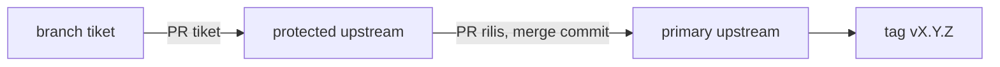

# Build, distribusi, dan rilis

Hanya **Release** yang build untuk distribusi, upload, push, dan membuat PR/MR. Build berat antre satu per satu (`build:heavy`, lihat `devices.md`).

## Nomor build
| Jenis | Nomor | Cara |
|---|---|---|
| Dev | angka tiket (`PROJ-1234` → `1234`); batch = tiket pertama | `$AGENT_WORKFLOW_DIR/bin/build-number.sh dev PROJ-1234 PROJ-1240` |
| Beta / Prod | terakhir + 1 | `$AGENT_WORKFLOW_DIR/bin/build-number.sh next asc=<n> firebase=<n> tag=<n> project=<n>` |

Sumber "terakhir" (kosongkan nilai jika sumber tidak tersedia, mis. `asc=`):
- `asc`: App Store Connect API, hanya jika ada key `.p8`.
- `firebase`: rilis terakhir di Firebase App Distribution.
- `tag`: tag git versi terbaru.
- `project`: `CURRENT_PROJECT_VERSION`/`CFBundleVersion` (iOS) atau `versionCode` (Android).

Exit 0 → pakai angkanya. Exit 2 = salah pakai (argumen/kode tiket tidak valid) → perbaiki perintah. Exit 3 (sumber beda/tidak ada) → berhenti dan tanya dengan ringkasan + `saran:` dari skrip. Nomor yang dikonfirmasi masuk blok `## Catatan agen` untuk di-commit user ke `CLAUDE.md` project (lihat `rules.md`).

## ID aplikasi
Build dev memakai ID terpisah berakhiran `.dev` (mis. `com.example.app.dev`) supaya bisa terpasang berdampingan dengan versi beta/prod. Jika project belum punya, tanya dulu sebelum menambah.

## Build per tiket
- **Dev**: selalu. **Beta**: juga. **Prod**: hanya setelah izin (gate).
- `--batch` (default): satu build dev untuk seluruh batch, setelah semua tiket lolos review atau dikeluarkan; perbaikan pasca-QA dikumpulkan lalu satu build ulang. Semua kode tiket di catatan rilis Firebase.
- `--separate`: satu build dev per tiket dari worktree tiketnya.

## Upload
Android (dev/beta):
```bash
./gradlew assemble<Flavor>Release
firebase appdistribution:distribute app/build/outputs/apk/.../app.apk \
  --app <firebase-app-id> --release-notes "PROJ-1234: ringkasan" --groups <grup>
```
iOS dev/beta ke Firebase:
```bash
xcodebuild archive -scheme <Scheme> -configuration <Config> -archivePath build/App.xcarchive
xcodebuild -exportArchive -archivePath build/App.xcarchive -exportOptionsPlist <ad-hoc.plist> -exportPath build/
firebase appdistribution:distribute build/App.ipa --app <firebase-app-id> --release-notes "..."
```
iOS ke TestFlight: `xcodebuild -exportArchive` dengan plist `method=app-store-connect` dan `destination=upload`.

**Prod (App Store / Play production) selalu berhenti dan tanya dulu.**

## PR/MR
- Push hanya ke `origin` (downstream): `git push origin <branch>`.
- Tujuan PR/MR: semua PR tiket ke upstream, base `<protected>` (branch project dari memory, `rules.md` → Lokasi). Tidak ada branch rilis.
- Dibuat **Draft** di awal pengerjaan (`/develop-tiket` langkah 4: `gh pr create --draft` / `glab mr create --draft`), diperbarui oleh push rutin Coder, ditandai siap di akhir (`gh pr ready` / `glab mr update <n> --ready`). Judul berisi kode tiket. Isi: ringkasan, link rencana dan laporan, Matriks env, nomor build + server API tiap build variant. Tanpa kredensial.
- Branch batch tidak pernah jadi sumber PR/MR; tiap PR/MR dari branch tiketnya sendiri.

## Merge PR tiket (/rilis-tiket)
Agen hanya merge PR tiket ke `<protected>` bila **semua** syarat ini lolos; gagal satu → lapor + saran, tidak merge.

| Syarat | Cara cek |
|---|---|
| Tiket Done dan punya PR/MR | Jira + `gh pr list` / `glab mr list` |
| PR/MR approved | `gh pr view` / `glab mr view` |
| CI hijau | status check PR/MR |
| Isi diff sesuai tiket | baca diff vs AC; `manifest-check.sh <base> <head> KODE...` bila perlu |
| Matriks env live **Sesuai kontrak** | cek ulang di server live (method aman) |

- Strategi merge sesuai memory project (squash atau merge commit); tracing rilis mendukung keduanya.
- Merge PR rilis ke `<primary>` bukan wewenang agen (lihat bawah).

## Rilis (/branch-manager)
Alurnya: PR rilis `<protected>` → `<primary>` di upstream, build live dari commit yang sama, tag setelah merge.

- Pakai merge commit untuk PR rilis, **bukan squash**, supaya `<primary>` tetap terkandung di `<protected>`. Upstream hanya squash → berhenti dan tanya.
- PR rilis dibuat dari branch upstream `<protected>` tanpa push: `gh pr create --repo <upstream> --base <primary> --head <protected>` / `glab mr create`. **Di-merge manusia**, tidak pernah oleh agen.
- Tracing perubahan: `$AGENT_WORKFLOW_DIR/bin/release-trace.sh <primary-ref> <protected-ref> PROJ ...` (TSV sha7/pr/kode/author/subject). Exit 0 = semua terlacak. Exit 1 = ada baris tak terlacak → tandai di laporan. Exit 2 = salah pakai/ref tidak ada. Exit 3 = `<primary>` bukan leluhur `<protected>` (hotfix belum di-back-merge) → berhenti dan tanya.
- Cek isi: dari TSV `release-trace.sh` (kolom kode), semua tiket harus Done; baris tak terlacak ditandai. Baris PR revert (`revert: <KODE> keluar dari rilis ...`) beserta pasangan revert-dari-revert-nya dicatat sebagai "dikeluarkan", bukan isi rilis.
- Build live dari `<sha-rilis>` (head `<protected>` saat tracing, dicatat di laporan dan PR rilis; worktree sementara, kunci `build:heavy`): Android `.aab`, iOS TestFlight. Upload ke store produksi tetap izin eksplisit per upload. Catatan rilis menyebut server + base URL API live.
- Setelah PR rilis merged oleh manusia: tag beranotasi `vX.Y.Z` di commit merge, push ke `upstream` dan `origin`. Tag tidak pernah ditimpa.
- **Keluarkan tiket dari rilis**: PR revert ke `<protected>` dari branch `revert/<KODE>-<n>` di downstream (`<n>` = nomor urut, mulai 1, naik tiap kali tiket yang sama dikeluarkan lagi), judul `revert: <KODE> keluar dari rilis vX.Y.Z`; merge PR revert hanya setelah user bilang "ya" (lalu aturan merge PR tiket). Tracing diulang setelah ter-merge. Agen mengomentari tiket itu: dikeluarkan dari vX.Y.Z + link PR revert.
- Tiket itu Done lagi → buat PR **revert dari revert** (branch `unrevert/<KODE>-<n>`, `<n>` sama dengan revert terakhir) dulu sebelum dihitung masuk rilis berikutnya. Lewati bila PR merged `unrevert/<KODE>-<n>` untuk `<n>` tertinggi sudah ada.
- Hotfix: sementara manual dengan bertanya (`--hotfix` belum ada). Dua fix bentrok → berhenti dan tanya.

## Jira setelah rilis
Komentar (baris pertama link laporan) berisi link build dan PR/MR, lalu geser ke Ready To Review. Done hanya oleh kolega.
