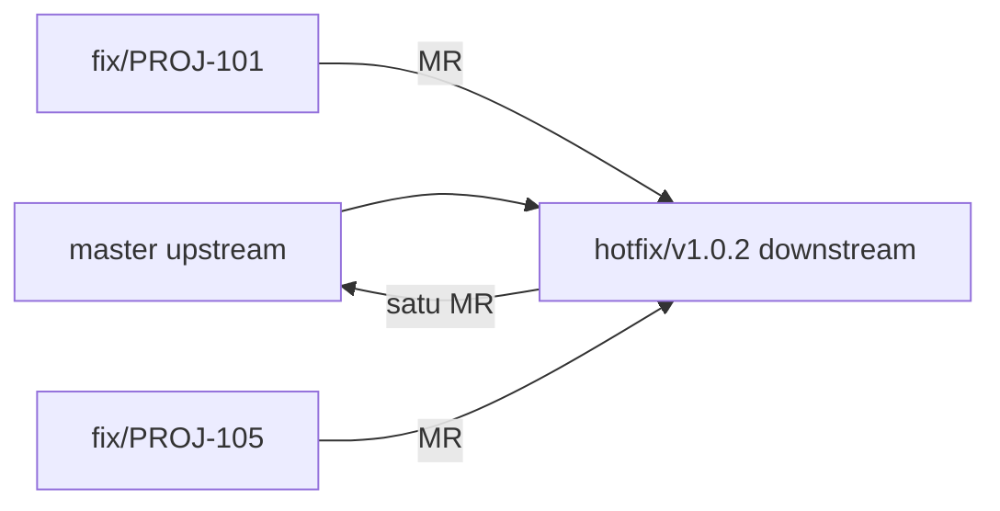

# Build, distribusi, dan rilis

Hanya **Release** yang build untuk distribusi, upload, push, dan membuat PR/MR. Build berat antre satu per satu (`build:heavy`, lihat `devices.md`).

## Nomor build
| Jenis | Nomor | Cara |
|---|---|---|
| Dev | angka tiket (`PROJ-1234` → `1234`); batch = tiket pertama | `$AGENT_WORKFLOW_DIR/bin/build-number.sh dev PROJ-1234 PROJ-1240` |
| Beta / Prod | terakhir + 1 | `$AGENT_WORKFLOW_DIR/bin/build-number.sh next asc=<n> firebase=<n> tag=<n> project=<n>` |

Sumber "terakhir" (kosongkan nilai jika sumber tidak tersedia, mis. `asc=`):
- `asc`: App Store Connect API, hanya jika ada key `.p8`.
- `firebase`: rilis terakhir di Firebase App Distribution.
- `tag`: tag git versi terbaru.
- `project`: `CURRENT_PROJECT_VERSION`/`CFBundleVersion` (iOS) atau `versionCode` (Android).

Exit 0 → pakai angkanya. Exit 2 = salah pakai (argumen/kode tiket tidak valid) → perbaiki perintah. Exit 3 (sumber beda/tidak ada) → berhenti dan tanya dengan ringkasan + `saran:` dari skrip. Nomor yang dikonfirmasi masuk blok `## Catatan agen` untuk di-commit user ke `CLAUDE.md` project (lihat `rules.md`).

## ID aplikasi
Build dev memakai ID terpisah berakhiran `.dev` (mis. `com.example.app.dev`) supaya bisa terpasang berdampingan dengan versi beta/prod. Jika project belum punya, tanya dulu sebelum menambah.

## Build per tiket
- **Dev**: selalu. **Beta**: juga. **Prod**: hanya setelah izin (gate).
- Worktree domain: satu build dev untuk seluruh batch; semua kode tiket di catatan rilis Firebase.

## Upload
Android (dev/beta):
```bash
./gradlew assemble<Flavor>Release
firebase appdistribution:distribute app/build/outputs/apk/.../app.apk \
  --app <firebase-app-id> --release-notes "PROJ-1234: ringkasan" --groups <grup>
```
iOS dev/beta ke Firebase:
```bash
xcodebuild archive -scheme <Scheme> -configuration <Config> -archivePath build/App.xcarchive
xcodebuild -exportArchive -archivePath build/App.xcarchive -exportOptionsPlist <ad-hoc.plist> -exportPath build/
firebase appdistribution:distribute build/App.ipa --app <firebase-app-id> --release-notes "..."
```
iOS ke TestFlight: `xcodebuild -exportArchive` dengan plist `method=app-store-connect` dan `destination=upload`.

**Prod (App Store / Play production) selalu berhenti dan tanya dulu.**

## PR/MR
- Push hanya ke `origin` (downstream): `git push origin <branch>`.
- Tujuan PR/MR:
  - Tiket ter-link ke tiket rilis → ke branch rilis (`release/vX.Y.Z` / `hotfix/vX.Y.Z`) di downstream.
  - Selain itu → langsung ke upstream (base `develop`, atau sesuai `CLAUDE.md` project).
- GitHub: `gh pr create`; GitLab: `glab mr create`. Judul berisi kode tiket. Isi: ringkasan, link laporan, nomor build. Tanpa kredensial.

## Tiket rilis dan hotfix (`/rilis-tiket`)
- Release membuat tiket di Jira (`mcp__claude_ai_Atlassian__createJiraIssue`): judul `[release-request] …` atau `[hotfix-release] …` berisi versi.
- Manifest = tiket yang di-link ke tiket rilis (`mcp__claude_ai_Atlassian__createIssueLink`).
- Sebelum membuat branch rilis/hotfix: berhenti dan tanya.
- Hotfix berasal dari `master` upstream atau tag versi live, **bukan** `develop`.
- Cek isi branch sebelum build:
  `$AGENT_WORKFLOW_DIR/bin/manifest-check.sh <base-ref> <head-ref> PROJ-101 PROJ-105`
  Exit 0 = cocok. Exit 1 = beda → berhenti, laporkan dua daftar. Exit 2 = salah pakai/ref tidak ada → perbaiki ref.
- Dua fix hotfix bentrok → berhenti dan tanya.
- Hotfix yang sudah di-build tidak ditambah; fix baru masuk versi berikutnya.
- Satu PR/MR ke upstream per rilis/hotfix. Setelah di-merge, Release membuat tag beranotasi `vX.Y.Z` di commit hasil merge dan push ke `upstream` serta `origin` (langkah 11 `/rilis-tiket`).

Contoh:


## Jira setelah rilis
Komentar (baris pertama link laporan) berisi link build dan PR/MR, lalu geser ke Ready To Review. Done hanya oleh kolega.
