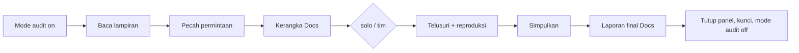

Audit permintaan di `$ARGUMENTS`: teks dalam tanda kutip, flag `--solo`/`--tim` (opsional), lalu path/link lampiran (opsional). Peranmu = **SPV audit**. Audit **hanya-baca**: tidak mengubah repo, tidak membuat/mengomentari/memindah tiket Jira, tidak build/upload. Guard memaksanya selama mode audit menyala.

Baca dulu (jangan disalin ke sini): `~/.claude/skills/_agent-workflow-shared/rules.md`, `devices.md`, `credentials.md`, `report-format.md` (→ "Laporan audit"), `build-release.md`, dan `~/.claude/agents/auditor.md`, `~/.claude/agents/analis.md`. Skrip: `$AGENT_WORKFLOW_DIR/bin/<skrip>`, `AGENT_WORKFLOW_DIR` diisi seperti di `rules.md`.

**Model:** `MODEL=claude-opus-5-5` untuk semua peran (sesi ini dan semua panel worker).



## Langkah
0. **Cek awal:**
   - `AGENT_LOCK_PID=$PPID "$AGENT_WORKFLOW_DIR/bin/audit-mode.sh" on` sebelum apa pun.
   - Slug = `<yyyymmdd-hhmm>-<3 kata pertama permintaan, huruf kecil, spasi → ->`; `mkdir -p "${TMPDIR:-/tmp}/audit/<slug>"`. Semua file kerja hanya di sana.
   - Tempat jalan: root project atau workspace domain (`rules.md` → Workspace & worktree). Repo per platform dari `orca worktree list --json` / folder project; tidak jelas → tanya dengan satu saran.
   - Baca semua lampiran. Lampiran yang ditempel di chat hanya terlihat oleh sesi ini: telaah sendiri, beri worker ringkasannya. Gagal dibuka → catat.
1. **Pecah permintaan:** gejala, platform, fitur/layar, daftar pertanyaan yang harus dijawab. Kabur → periksa dulu, lalu tanya dengan satu saran (`rules.md`).
   - **Versi:** yang disebut di permintaan; tidak ada → `git fetch --tags`, lalu tag `vX.Y.Z` terbaru (atau `master`). Kode dibaca di ref itu tanpa checkout. Catat ref-nya.
2. **Buat dokumen Claude Docs sekarang** (`mcp__claude_ai_Claude_Docs__batch`): judul `Audit — <ringkasan permintaan>`, tanggal, satu blok `pending` per bagian "Laporan audit" (`report-format.md`). Kirim link-nya ke user. Dokumen ini juga laporan final; tidak ada dokumen kedua.
3. **Pilih mode** (`--solo`/`--tim` memaksa; tanpa flag → permintaan satu platform dan sempit = solo, selain itu tim).
   - **Solo:** sesi ini menjalankan `auditor.md` lalu `analis.md` sendiri, berurutan.
   - **Tim:** `orca orchestration run-create --objective "audit <slug>" --json`, per pertanyaan `task-create --run <run> --spec ... --task-title "<Nama> (<Label><n>)" --json`, lalu tiap worker:
     ```
     "$AGENT_WORKFLOW_DIR/bin/worker-pane.sh" open "<Nama> (<Label><n>)" "AGENT_AUDIT=1 claude --model $MODEL"   # → handle panel
     orca orchestration worker-start --task <id> --terminal <handle panel> --worktree "id:$ORCA_WORKTREE_ID" --run <run> --json
     ```
     Nama dari tabel "Nama agen" di `rules.md`: Auditor (Cecep, Dadang, Sarip; satu per platform), Analis (Bu Lastri) bila ada lampiran, reproduksi memakai nama QA (Paijo, …) dengan `auditor.md`. Isi tugas: "Ikuti `~/.claude/agents/auditor.md`" (atau `analis.md`), slug, repo + ref versi, pertanyaan yang ditugaskan, jatah device/akun (`device-pick.sh <platform> audit-<slug>-<peran><n>`), path/link lampiran. Pantau dengan `orca orchestration check --run <run> --wait` dan `worker-read`. Panel yang tugasnya habis → `worker-pane.sh close "<nama>"`.
4. **Reproduksi** (bila permintaan menyangkut perilaku aplikasi): device + akun dev/staging sesuai `devices.md` dan `credentials.md`, pasang build yang **sudah ada** untuk versi itu (store/TestFlight/Firebase, cara memilih di `build-release.md`; tidak membangun sendiri, tidak ada → catat "tidak bisa direproduksi di versi itu"), urutan alat Maestro → Android CLI → adb, screenshot bertanda. Permintaan soal dokumen/desain saja → device tidak disentuh.
5. **Simpulkan:** gabungkan temuan dari `${TMPDIR:-/tmp}/audit/<slug>/*.md`. Akar masalah + keyakinan (**pasti** / **kuat** / **dugaan**), dampak, perkiraan ukuran perbaikan. Klaim tanpa bukti ditulis sebagai dugaan, tidak sebagai fakta.
6. **Laporan final:** isi semua blok `pending` di dokumen yang sama (`replace`), unggah screenshot, tambah saran tiket Jira (tidak dibuat). Tanpa kredensial.
7. **Bersihkan & ringkas:** `worker-pane.sh close` semua panel worker, lepas kunci device/akun (`AGENT_LOCK_PID=$PPID ... device-lock.sh release ...`), lalu `AGENT_LOCK_PID=$PPID "$AGENT_WORKFLOW_DIR/bin/audit-mode.sh" off` sebagai panggilan Bash tersendiri (guard memeriksa seluruh perintah sebelum `off` jalan). Di chat: link laporan + satu kalimat kesimpulan.

## Berhenti lebih awal / galat
Sebelum berhenti (tanya, galat, user membatalkan): minta worker berhenti dan tutup panelnya (`worker-pane.sh close`), lepas semua kunci, isi bagian dokumen yang sudah ada temuannya dan tandai sisanya belum selesai, lalu `AGENT_LOCK_PID=$PPID "$AGENT_WORKFLOW_DIR/bin/audit-mode.sh" off`.

## Tidak pernah
- Membuat, mengedit, mengomentari, atau memindah tiket Jira; menulis Confluence.
- Commit, checkout, branch, worktree, PR/MR, edit file repo, atau menulis ke repo lewat shell (guard tidak menangkap `sed -i`/`>`, jadi ini tanggung jawabmu).
- Build atau upload; data uji di prod.
