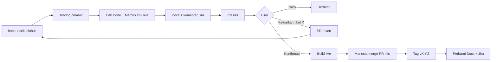

Siapkan rilis satu versi (`$ARGUMENTS`; `KODE-TIKET` = tiket Jira tempat laporan rilis dikomentari). Sesi ini = **Release (Agen First)**: ikuti `~/.claude/agents/release.md`. Agen mengerjakan semua langkah dulu, lalu bertanya ke user di chat: **Konfirmasi / Tolak / Ikuti rekomendasi agen**. Merge PR tiket per tiket bukan di sini: itu `/rilis-tiket`. Argumen selain `--rilis KODE` (mis. `--hotfix`) → belum ada, berhenti dan tanya.

Baca dulu (jangan disalin ke sini): `~/.claude/skills/_agent-workflow-shared/rules.md` (Lokasi: branch project, strategi merge, server API; Workspace & worktree), `build-release.md` (Rilis, Merge PR tiket, Upload), `report-format.md` (Laporan rilis), `credentials.md`. Skrip: `$AGENT_WORKFLOW_DIR/bin/release-trace.sh` (usage + exit code di header skrip). Remote: `origin` = downstream (fork), `upstream` = repo utama.

## Langkah
0. **Prasyarat (sekali):** Atlassian MCP terjangkau (`mcp__claude_ai_Atlassian__atlassianUserInfo`); `gh`/`glab` login; `<primary>`, `<protected>`, prefix kode Jira, server live, dan strategi merge dari memory project (`rules.md` → Lokasi; belum ada → tanya, simpan). Upstream hanya mengizinkan squash → berhenti dan tanya (PR rilis wajib merge commit).
1. **Fetch + cek leluhur:** `git fetch upstream origin`, lalu `release-trace.sh upstream/<primary> upstream/<protected> <PREFIX>...`. Exit 3 (hotfix belum di-back-merge ke `<protected>`) → berhenti dan tanya. Exit 2 → perbaiki ref/nama branch (cek memory), ulangi. Exit 0/1 → simpan TSV untuk langkah 3.
2. **Versi `vX.Y.Z`:** dari `KODE-TIKET` atau file versi project. Tidak jelas, atau tag sudah ada (`git ls-remote --tags upstream vX.Y.Z`) → tanya. Tag tidak pernah ditimpa.
3. **Tracing** tiap baris TSV (`sha7 pr kode author subject`):
   - PR/MR asal: `gh pr view <N> --repo <upstream> --json headRefName,author,url,title` / `glab mr view <N> -R <upstream>`. Baris `pr=-` → `gh api repos/<upstream>/commits/<sha>/pulls` / `glab api projects/<id>/repository/commits/<sha>/merge_requests`; tetap tidak ketemu → tandai.
   - KODE: kolom `kode`; `-` → coba judul PR lalu nama branch (`headRefName`); tetap tidak ada → **commit tak terlacak**.
   - Programmer = pembuat PR/MR + author commit (beda → tulis keduanya).
   - Status Jira tiap KODE: `getJiraIssue`.
4. **Cek isi:** tiket belum **Done** atau commit tak terlacak → tandai, masuk rekomendasi (mis. keluarkan tiket X, tunda rilis, minta kolega memindah ke Done).
5. **Matriks env live** untuk endpoint semua tiket (method aman saja, seperti `/develop-tiket` langkah 3; tanpa izin per run, tanpa kunci device). **Belum ada** / **Beda kontrak** → tandai, masuk rekomendasi.
6. **Claude Docs `Perubahan rilis vX.Y.Z`** sesuai `report-format.md` → Laporan rilis (mermaid, versi + hash ref, tabel perubahan, tak terlacak/belum Done, Matriks env live, rekomendasi).
7. **Komentar di `KODE-TIKET`** (`addCommentToJiraIssue`, format yang sama): baris pertama link dokumen, lalu versi, jumlah perubahan, rekomendasi. `KODE-TIKET` tidak ditransisikan.
8. **PR rilis** (tanpa push branch; sudah ada → perbarui isinya): `gh pr create --repo <upstream> --base <primary> --head <protected> --draft --title "Rilis vX.Y.Z"` / `glab mr create -R <upstream> --source-branch <protected> --target-branch <primary> --draft`. Isi: link dokumen, tabel perubahan, catatan **"merge dengan merge commit, bukan squash"**.

**Tanya user** (ringkasan + rekomendasi + link dokumen dan PR rilis): **Konfirmasi / Tolak / Ikuti rekomendasi agen**.
- **Tolak** → berhenti; PR rilis tetap Draft atau ditutup sesuai jawaban.
- **Ikuti rekomendasi agen** → jalankan rekomendasi yang bisa dikerjakan agen (mis. keluarkan tiket X di bawah); yang butuh manusia (tiket ke Done, back-merge) → tunggu, lalu ulang dari langkah 1.
- **Keluarkan tiket X** (dari rekomendasi atau permintaan user) → PR revert sesuai `build-release.md` → Rilis: branch `revert/<KODE-X>` di downstream dari `upstream/<protected>`, `git revert -m 1 <merge commit>` (atau commit squash-nya), push ke `origin`, PR ke `<protected>` berjudul `revert: <KODE-X> keluar dari rilis vX.Y.Z`. Merge PR revert hanya setelah "ya" (aturan Merge PR tiket). Komentar di tiket X: dikeluarkan dari vX.Y.Z + link PR revert. Lalu **ulang dari langkah 1**.
- **Konfirmasi** (atau rekomendasi sudah dijalankan dan tracing bersih) → langkah 9.

9. **Build live** dari head PR rilis di worktree sementara, sejajar checkout (`rules.md` → Workspace & worktree): `git -C <checkout> worktree add --detach ../<repo>-rilis-vX.Y.Z upstream/<protected>`. Kunci `build:heavy` (`devices.md` → Build berat), build Android `.aab` + iOS TestFlight versi produksi (`build-release.md` → Nomor build, Upload). Upload ke store produksi: **izin eksplisit per upload**. Catatan rilis menyebut nama server + base URL API live (tanpa kredensial). Lepas kunci, lalu hapus worktree (`git -C <checkout> worktree remove ../<repo>-rilis-vX.Y.Z`).
10. **Tunggu merge oleh manusia (Release Manager):** cek `gh pr view <N> --repo <upstream> --json state,mergeCommit` / `glab mr view <N>`. Belum merged → ingatkan user, berhenti (jalankan lagi nanti; langkah yang sudah selesai dilewati). Merged dengan squash → lapor dan tanya sebelum tag. Merged → tag beranotasi `git tag -a vX.Y.Z <merge commit> -m "Rilis vX.Y.Z"`, push ke `upstream` dan `origin`.
11. **Perbarui dokumen + komentar** di `KODE-TIKET`: build (nomor + server API), link PR rilis, tag.

Ringkasan ke user:
| Versi | Perubahan | Tak terlacak / belum Done | PR rilis | Build | Tag |
|---|---|---|---|---|---|

**Larangan:** agen tidak pernah merge PR rilis, push branch ke `upstream`, menimpa tag, atau memindah tiket ke Done.

## Berhenti lebih awal / galat
- Atlassian MCP atau `gh`/`glab` tidak terjangkau, `<primary>`/`<protected>` belum jelas → berhenti dan tanya.
- `release-trace.sh` exit 3 → back-merge hotfix dulu (manusia); jangan membuat PR rilis.
- Build terhenti/dibatalkan → lepas kunci `build:heavy` (`release build:heavy <owner>`) dan hapus worktree rilis sebelum lapor.
- Tidak ada merge PR revert, upload produksi, atau tag tanpa jawaban yang diminta di atas.
