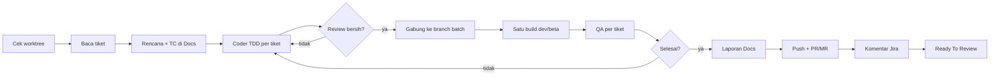

Kerjakan satu atau lebih tiket Jira (`$ARGUMENTS`) sebagai satu **batch**. Sesi ini = **SPV**: ikuti `~/.claude/agents/spv.md` (tidak menulis kode produk, tidak memindah ke Done).

Baca dulu (jangan disalin ke sini): `~/.claude/skills/_agent-workflow-shared/rules.md`, `devices.md`, `credentials.md`, `build-release.md`, `report-format.md`, serta `~/.claude/agents/{coder,reviewer,qa,release}.md`. Skrip: `$AGENT_WORKFLOW_DIR/bin/<skrip>` (`AGENT_WORKFLOW_DIR` diisi seperti di `rules.md`). Setiap panggilan `device-lock.sh`/`device-pick.sh` diawali `AGENT_LOCK_PID=$PPID` di panggilan Bash yang sama.

## Langkah
0. **Guard:** kenali domain (`rules.md` → Workspace & worktree: `$ORCA_WORKTREE_ID`). Root project (`isMainWorktree: true`) atau tidak ketemu → berhenti: "Jalankan dari workspace domain". Tentukan checkout domain (git worktree workspace, atau `<repo>-<slug>` untuk workspace folder; tidak ada → berhenti dan minta user membuatnya), lalu kunci `checkout:<path>`. Branch batch = branch checkout domain saat ini (hanya lokal, **tidak pernah** di-push ke upstream).
1. **Prasyarat (sekali):** Atlassian MCP terjangkau (`mcp__claude_ai_Atlassian__atlassianUserInfo`); `~/.agent-workflow/jira-transitions.json` punya entri project dengan id **Ready To Review** (belum → "Setup transisi Jira" di `rules.md`). Akun uji ada (`credentials.md`); tidak ada → berhenti & tanya.
2. **Baca tiket** + komentar + tiket terkait/blocking (`getJiraIssue`, `searchJiraIssuesUsingJql`). Catat per tiket: AC, platform (ios/android/api), dan apakah ter-link ke tiket `[release-request]`/`[hotfix-release]` (→ base & tujuan MR = branch rilis itu di `origin`; selain itu base `develop` atau sesuai `CLAUDE.md`). Tiket blocking belum selesai / requirement kabur → periksa dulu, lalu tanya. Cari spec API & kontrak Pact di repo; tidak ada → tanya; jawabannya jadi blok `## Catatan agen` untuk user (lihat `rules.md`).
3. **Rencana + test case** di Claude Docs (`mcp__claude_ai_Claude_Docs__batch`): satu dokumen per batch, TC per AC per tiket. `--solo`/tiket kecil: catatan singkat cukup.
4. **Pilih mode** (`--solo`/`--tim` memaksa; tanpa flag → SPV menilai: 1 tiket kecil = solo, selain itu tim). **Tidak ada workspace/worktree baru**: semua di checkout domain. Branch tiket `feature/|fix/|hotfix/|docs/|chore/<KODE>` dibuat dari `<base>` di checkout domain, dikerjakan bergantian (satu branch aktif); tiap tiket tetap MR sendiri.
   - **Solo:** SPV sendiri menjalankan peran Coder → Reviewer (review diff sendiri dengan daftar cek `reviewer.md`, catat di laporan bahwa review bukan independen) → QA → Release, berurutan, sesuai file perannya.
   - **Tim:** `orca orchestration run-create --objective "develop <KODE...>" --json` → per tiket `task-create --run <run> --spec ... --task-title "<KODE> code"`, lalu tiap worker sebagai **panel split** di terminal SPV (`terminal split --command "claude --model <model>"` → `worker-start --task <id> --terminal <handle panel> --worktree current --run <run> --json`, lengkapnya di `rules.md` → Orkestrasi; jangan `--agent`, itu membuka tab baru):
     | Peran | Model | Catatan |
     |---|---|---|
     | Coder | `claude-sonnet-5-5` | satu tiket/branch aktif; coder ke-2+ hanya bila file/modul terpisah, sebut batasnya di tugas |
     | Reviewer | `claude-opus-5-5` | bukan coder tiket itu; baca diff branch tiket |
     | QA (2-3) | `claude-sonnet-5-5` | uji build batch |
     | Release | `claude-haiku-5-5` | |
     Coder tidak boleh `git checkout` branch lain; hanya SPV yang mengganti branch checkout, setelah coder selesai. Tidak aman dibagi → cadangan solo (`rules.md`). Isi tugas: "Ikuti `~/.claude/agents/<peran>.md`", kode tiket, AC/TC, branch, batas file, jatah device/akun, folder laporan. Pantau dengan `orca orchestration check --run <run> --wait` dan `worker-read --dispatch <id>`.
5. **Kode (TDD) → review:** Coder commit lokal di branch tiket (pesan menyebut KODE). Reviewer memeriksa performa/crash; temuan **wajib** (Critical/Important) → kembali ke Coder, review ulang sampai bersih.
6. **Branch batch:** di checkout domain, `git checkout <branch batch>` lalu `git merge --no-ff <branch tiket>` untuk tiap tiket yang lolos review. Konflik → berhenti dan tanya (sebut file dan tiketnya).
7. **Build (sekali per batch, oleh Release):** kunci `build:heavy` dulu (owner `<KODE-pertama>-release1`), lepas sesudahnya; build antre satu per satu.
   - Dev selalu: nomor = `build-number.sh dev <semua KODE batch>`; semua KODE di catatan rilis Firebase.
   - Beta: `build-number.sh next asc=… firebase=… tag=… project=…`; exit 3 → berhenti dan tanya (tim: `gate-create`).
   - Prod: hanya lewat gate/izin eksplisit user, tidak pernah otomatis.
8. **QA per tiket** di build dev batch, folder `${TMPDIR:-/tmp}/qa/<KODE>/`:
   - SPV membagi jatah: per QA run, **satu** `device-pick.sh <ios|android> <KODE>-qa<n>` per platform (platform disebut di tugas), dipakai untuk semua TC run itu; akun lewat `device-lock.sh acquire account:qa.userN <KODE>-qa<n>`.
   - UI → Maestro + screenshot bertanda; API → Schemathesis (dev/staging); kontrak → Pact. Spec/kontrak tidak ada di repo → TC itu Tertahan + tanya.
   - QA menulis `report.md` + `*.png` sesuai "Laporan uji"; Gagal → kembali ke langkah 5.
9. **Putuskan selesai** (per tiket) hanya bila: semua TC AC **Lulus**, atau **Tertahan** dengan alasan tertulis; review tanpa temuan wajib; tes project lulus. Belum → ulangi 5–8 untuk tiket itu.
10. **Laporan:** SPV publikasikan laporan uji per tiket ke Claude Docs (`mcp__claude_ai_Claude_Docs__batch`, unggah screenshot). **Tunggu link dokumen kembali** sebelum lanjut; tanpa link → jangan komentar Jira.
11. **Push + PR/MR (Release):** `git push origin <branch tiket>` (hanya `origin`, branch batch tidak di-push). Tujuan: ter-link tiket rilis → branch rilis di downstream; selain itu → upstream base `develop`/`CLAUDE.md`. `gh pr create` bila host remote GitHub, `glab mr create` bila GitLab (cek `git remote get-url`). Judul berisi KODE; isi ringkasan, link laporan, nomor build.
12. **Komentar Jira** (`addCommentToJiraIssue`) per tiket: baris pertama link laporan, lalu link rencana, build dev/beta, PR/MR, ringkasan Lulus/Tertahan.
13. **Transisi** ke Ready To Review (`transitionJiraIssue`, id dari `jira-transitions.json`). Tidak pernah Done.
14. **Bersihkan & ringkas:** pastikan semua kunci (device, akun, `build:heavy`, `checkout:*`) dilepas.

   | KODE | Status | Laporan | Build | PR/MR |
   |---|---|---|---|---|

## Berhenti lebih awal / galat
Sebelum berhenti (guard, tanya, galat, user membatalkan): lepas semua kunci milik batch ini (`AGENT_LOCK_PID=$PPID "$AGENT_WORKFLOW_DIR/bin/device-lock.sh" release <resource> <owner>` untuk tiap device, `checkout:*`, `account:*`, `build:heavy`), minta worker tim melakukan hal sama lalu hentikan, dan laporkan posisi terakhir per tiket. Pertanyaan wajib (`rules.md`): di dalam run pakai `orca orchestration gate-create --task <id> --question "<ringkasan + saran>" --options '["Ya","Tidak"]'`; di solo tanya di chat.
