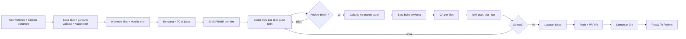

Kerjakan satu atau lebih tiket Jira (`$ARGUMENTS`). Sesi ini = **SPV**: ikuti `~/.claude/agents/spv.md` (tidak menulis kode produk, tidak memindah ke Done).

Baca dulu (jangan disalin ke sini): `~/.claude/skills/_agent-workflow-shared/rules.md`, `devices.md`, `credentials.md`, `build-release.md`, `report-format.md`, serta `~/.claude/agents/{coder,reviewer,qa,release}.md`. Skrip: `$AGENT_WORKFLOW_DIR/bin/<skrip>` (`AGENT_WORKFLOW_DIR` diisi seperti di `rules.md`). Setiap panggilan `device-lock.sh`/`device-pick.sh` diawali `AGENT_LOCK_PID=$PPID` di panggilan Bash yang sama.

**Alur** (`--batch` default; terpisah dari `--solo`/`--tim`, boleh digabung):
- **`--batch`:** semua tiket = satu batch: satu rencana, satu branch batch, **satu build**, QA di build itu. Proses berat jalan **sekali untuk semua tiket**, di titik tunggu langkah 7 dan 9. Tidak ada build, pasang, atau QA per tiket.
- **`--separate`:** tiap tiket jalur sendiri: rencana, build dev dari branch tiket, QA, laporan, dan selesai sendiri; tanpa branch batch. Build tetap antre `build:heavy`.
- **`--uat`:** sesudah QA lulus, user menguji sendiri build dev di HP fisik sementara SPV memantau log (langkah 8b). `--batch`: satu slot untuk build batch, owner `human-<KODE pertama>`; `--separate`: satu slot per tiket. Tanpa `--uat` tidak ada slot manusia.

## Langkah
0. **Guard:** kenali domain (`rules.md` → Workspace & worktree: `$ORCA_WORKTREE_ID`). Root project (`isMainWorktree: true`) atau tidak ketemu → berhenti: "Jalankan dari workspace domain". Tentukan checkout domain (git worktree workspace, atau `<repo>-<slug>` untuk workspace folder; tidak ada → buat sesuai `rules.md`), lalu kunci `checkout:<path>`. Branch batch (`--batch`) = branch checkout domain saat ini (hanya lokal, **tidak pernah** di-push ke upstream).
1. **Prasyarat (sekali):** Atlassian MCP terjangkau (`mcp__claude_ai_Atlassian__atlassianUserInfo`); `~/.agent-workflow/jira-transitions.json` punya entri project dengan id **Ready To Review** (belum → "Setup transisi Jira" di `rules.md`). Akun uji ada (`credentials.md`); tidak ada → berhenti & tanya. **Sinkron sumber** sama persis dengan `/validate-tiket` langkah 1 (business discovery, desain/mockup, kontrak API, blueprint; lokasi dari memory project; `git fetch`/`git pull` lalu `graphify update`); catat ref yang dibaca.
2. **Baca tiket** + komentar + tiket terkait/blocking (`getJiraIssue`, `searchJiraIssuesUsingJql`). Catat per tiket: AC, platform (ios/android/api), dan jenisnya (hotfix atau feature/fix) → `<base>` dan tujuan MR menurut tabel `rules.md` → Workspace & worktree; `<primary>`/`<protected>` dari memory project (belum ada → tanya, simpan). Tiket blocking belum selesai / requirement kabur → periksa dulu, lalu tanya. Cari spec API & kontrak Pact di repo; tidak ada → tanya; jawabannya jadi blok `## Catatan agen` untuk user (lihat `rules.md`).
   - **Jejak pengerjaan sebelumnya** (tiket kembali ke Todo): ada branch `origin/*/<KODE>` atau `origin/*/<KODE>-r<n>` (tanpa `revert/`/`unrevert/`) atau PR/MR (deteksi dengan perintah seperti `/validate-tiket` langkah 3) → **wajib baca** komentar review manusia (PR/MR + Jira) sejak putaran terakhir, selain komentar arahan QA dari `/rilis-tiket`. Hasilnya daftar **Yang ditolak** (dipakai langkah 4); bertentangan dengan laporan validasi ulang → tanya user. Jejak ada tapi tidak ada komentar penolakan (mis. tiket dipindah ke Todo manual) → tanya user apa yang ditolak. PR/MR tiket sudah **merged** → jangan dipakai ulang: branch baru `<jenis>/<KODE>-r<n>` dari base terkini dan Draft PR/MR baru yang menyebut PR/MR lama.
   - **Gerbang validasi:** cari komentar laporan validasi terbaru (baris pertama = link Docs) dan **baca laporannya**, solo maupun tim.
     | Kondisi | Tindakan |
     |---|---|
     | Belum pernah divalidasi | Tanya user: jalankan `/validate-tiket` dulu, atau lanjut dengan cek singkat SPV (dicatat di rencana) |
     | **Tidak layak** | Berhenti & tanya |
     | **Layak dengan catatan** | Tiap catatan masuk rencana dan jadi TC atau tugas |
     | **Layak** | Lanjut |
   - **Dokumen terbaru:** dari sumber yang disinkron, baca bagian yang terkait tiket: business discovery (tujuan, aturan bisnis), mockup/desain (layar, state, teks), kontrak API (endpoint, skema), blueprint (modul/arsitektur yang tersentuh). Bandingkan dengan ref yang tercatat di laporan validasi: berubah sejak validasi dan menyentuh AC, desain, atau kontrak → sebut perbedaannya dan tanya user sebelum lanjut; berubah kecil → catat di rencana.
   - Hasilnya **Acuan tiket**: link/path + ref tiap dokumen di atas + link laporan validasi. Acuan ini masuk rencana, brief Planner, prompt Coder (mockup, kontrak), dan tugas QA (kontrak untuk Schemathesis/Pact). Tidak ada di sumber → tulis "tidak ada" di acuan; tiket UI tanpa mockup → tanya user.
3. **Mode, worktree tiket, Matriks env** (sebelum rencana, supaya rencana berpijak pada kode dan server nyata):
   - **Mode:** `--solo`/`--tim` memaksa; tanpa flag → SPV menilai: 1 tiket kecil = solo, selain itu tim.
   - **Worktree tiket:** tiap tiket di `<repo>-<nomor>` sejajar checkout domain, branch `feature/|fix/|hotfix/|docs/|chore/<KODE>` dari `<base>` **ref remote terbaru** (`git fetch` dulu; `upstream/<protected>`, `upstream/<primary>` untuk hotfix; base + hash dicatat di rencana; worktree lama yang tertinggal → tanya rebase/merge; ada jejak → **pakai** branch, worktree, dan PR/MR yang ada (tidak membuat baru); `rules.md` → Workspace & worktree). Tiket berbeda jalan paralel, tiap tiket PR/MR sendiri. Tidak ada project/workspace Orca baru.
   - **Matriks env:** cek endpoint yang disentuh tiket (dari kontrak di Acuan) di tiap server: URL dev/beta/live dari memory project (`rules.md` → Lokasi; belum ada → tanya, simpan). Tim: **Contract Runner** (`contract-runner.md`); solo: SPV sendiri.
     | Server | Cara cek |
     |---|---|
     | dev | Schemathesis endpoint tiket + verifikasi Pact |
     | beta, live | Hanya method aman (GET/HEAD/OPTIONS) + interaksi Pact yang aman; **tanpa fuzzing, tanpa menulis data**. Endpoint tulis → cek keberadaannya dari spec yang disajikan server atau respons method aman; tidak bisa → **Tidak dicek** + alasan |
     Hasil per endpoint × server: **Sesuai kontrak** / **Beda kontrak** / **Belum ada** / **Tidak dicek**. Beda dengan kontrak di Acuan → sebut bedanya dan tanya user sebelum rencana. Matriks masuk rencana, PR/MR, prompt Coder, dan tugas QA.
4. **Rencana + test case, bagi kerja, Draft PR/MR.**
   - **Rencana** di Claude Docs (`mcp__claude_ai_Claude_Docs__batch`), berpijak pada worktree/branch + base hash, Acuan tiket (bisnis, mockup, kontrak, blueprint), dan Matriks env. `--batch`: satu dokumen untuk semua tiket; `--separate`: satu dokumen per tiket. TC per AC per tiket, tiap TC menyebut server yang diuji; endpoint **Belum ada** di suatu server → TC server itu langsung Tertahan dengan alasan. TC yang butuh hardware asli ditandai `(fisik)` (`devices.md`). **Tim:** SPV memanggil **Planner** (`planner.md`) dengan brief; Planner menulis dokumen `Rencana <KODE> — <judul singkat>` dan membalas link + ringkasan + status (Siap / Butuh jawaban / Tidak bisa); SPV memeriksanya terhadap device, antrean build, dan batch sebelum membagi tugas. Planner tidak tersedia atau **Tidak bisa** → SPV menulis sendiri dan mencatatnya di dokumen. **Solo**/tiket kecil: SPV menulis sendiri, catatan singkat cukup. Rencana ini menentukan prosedur semua agen sesudahnya.
   - **Tiket dengan jejak (revisi):** rencana memuat bagian **"Yang ditolak"**: tiap poin dari langkah 2 jadi tugas bernomor atau TC (poin tanpa tugas/TC = tidak boleh). PR/MR yang ada dikembalikan ke Draft (`gh pr ready <n> --undo` / `glab mr update <n> --draft`) dan tidak dibuat Draft baru; link tetap dicatat di rencana.
   - **Draft PR/MR per tiket (Release), sebelum Coder mulai** (tiket tanpa jejak): branch belum beda dari base → `git commit --allow-empty -m "chore: <KODE> mulai pengerjaan"`; `git push -u origin <branch tiket>`; lalu `gh pr create --draft` / `glab mr create --draft` ke tujuan (`build-release.md` → PR/MR). Isi: link rencana, Acuan tiket, Matriks env. Link PR/MR dicatat di rencana.
   - **Solo:** SPV sendiri menjalankan peran Coder → Reviewer (review diff sendiri dengan daftar cek `reviewer.md`, catat di laporan bahwa review bukan independen) → QA → Release, berurutan, sesuai file perannya.
   - **Tim:** tiap worker = **teammate** (tool Agent dengan `name: "<Nama>-<Label><n>"`, `subagent_type: <peran>`, `model` dari tabel); tampil sebagai panel split di tab SPV. Agen yang sama dipakai ulang lewat SendMessage; SPV **memantau tiap teammate sampai tugasnya tuntas** (status berkala, verifikasi hasil), lalu menghentikannya dan menutup panelnya; lengkapnya di `rules.md` → Orkestrasi. Teammate mode mati → tanya user (`rules.md`):
     | Peran | Model | Catatan |
     |---|---|---|
     | Planner | `claude-fable-5-2` (jangan isi `model`: frontmatter yang berlaku) | hanya-baca; dipanggil di langkah 4 dan saat eskalasi, dihentikan setelah membalas |
     | Contract Runner | `claude-sonnet-5-5` | langkah 3: Matriks env; dihentikan setelah membalas |
     | Coder | `claude-sonnet-5-5` | di worktree tiketnya; coder ke-2+ di tiket yang sama hanya bila file/modul terpisah, sebut batasnya di tugas |
     | Reviewer | `claude-opus-5-5` | bukan coder tiket itu; baca diff branch tiket, tulis review di PR/MR |
     | QA (2-3) | `claude-sonnet-5-5` | uji build batch |
     | Release | `claude-haiku-5-5` | |
     Coder tidak boleh `git checkout` branch lain atau pindah ke worktree tiket lain; path worktree disebut di tugas. Tidak aman dibagi → cadangan solo (`rules.md`). Isi tugas: "Ikuti `~/.claude/agents/<peran>.md`", kode tiket, AC/TC, branch, batas file, jatah device/akun, folder laporan. Laporan worker datang lewat pesan teammate.
5. **Kode (TDD) → review:**
   - **Coder** sebelum menulis kode mengirim **satu daftar cek silang** ke SPV: kontrak API yang dipakai (path, method, field, kode galat, status di Matriks env) dan detail desain yang di-slice (layout, spacing, teks, state, dark mode); tunggu jawaban. Commit kecil di branch tiket (pesan menyebut KODE) dan **push rutin** `git push origin <branch tiket>` tiap commit dengan tes lulus, supaya Draft PR/MR selalu terbarui. Coder hanya menyentuh branch tiketnya; branch batch tidak pernah dikerjakan Coder.
   - **Reviewer** membaca diff branch tiket dengan prioritas: (1) **performa ringan + keamanan** (crash, main thread, memori, jaringan berulang; kredensial/token, validasi input, data sensitif di log/storage, otorisasi); (2) **logika sesuai aturan bisnis dan AC** (Acuan tiket). Review ditulis di PR/MR (`gh pr review <n> --comment` / `glab mr note <n>`), tiap putaran satu komentar dengan tabel temuan; ringkasannya dilapor ke SPV.
   - Temuan **wajib** (Critical/Important) → kembali ke Coder, review ulang sampai bersih. Lewat 2 putaran revisi (mode tim) → SPV memanggil Planner untuk analisis akar masalah + revisi rencana; rencana sudah direvisi 2 kali dan masih gagal → berhenti & tanya.
6. **Branch batch** (`--batch`; `--separate` lewati): persiapan build untuk QA. Di checkout domain, `git checkout <branch batch>` lalu `git merge --no-ff <branch tiket>` untuk tiap tiket yang lolos review. Merge ini hanya salinan lokal untuk build: branch tiket tetap utuh, tetap di-push ke `origin`, dan PR/MR tiap tiket tetap dari branch tiketnya sendiri (bersih dari tiket lain). Perbaikan selalu di branch tiket lalu merge ulang, tidak pernah langsung di branch batch. Konflik → berhenti dan tanya (sebut file dan tiketnya).
7. **Build (oleh Release):** kunci `build:heavy` dulu (owner `<KODE-pertama>-release1`), lepas sesudahnya; build antre satu per satu. Dipegang tiket Jira lain → tanya user tunggu atau dahulukan (`devices.md` → Build berat).
   - `--batch`: **titik tunggu.** Build hanya setelah **semua** tiket lolos review dan di-merge, atau dikeluarkan dari batch (alasan tertulis di rencana). Satu build dari branch batch. Jangan build saat sebagian tiket masih dikerjakan.
   - `--separate`: satu build per tiket dari worktree tiketnya, begitu tiket itu lolos review.
   - Dev selalu: nomor = `build-number.sh dev <KODE batch, atau satu KODE di --separate>`; semua KODE build itu di catatan rilis Firebase.
   - **Tiap build variant menyebut server API-nya**: nama env + base URL API (dari konfigurasi flavor/scheme project; pemetaan variant → env disimpan di memory project). Ditulis di catatan rilis Firebase/TestFlight, laporan uji, PR/MR, dan komentar Jira. Tanpa kredensial.
   - Beta: `build-number.sh next asc=… firebase=… tag=… project=…`; exit 3 → berhenti dan tanya.
   - Prod: hanya dengan izin eksplisit user, tidak pernah otomatis.
8. **QA per tiket** di build dev (`--batch`: build batch, **dipasang sekali per device** lalu semua tiket diuji di sana; `--separate`: build tiket itu), folder `${TMPDIR:-/tmp}/qa/<KODE>/`:
   - SPV membagi jatah: per QA run, **satu** `device-pick.sh <ios|android> <KODE>-qa<n>` per platform (platform disebut di tugas), dipakai untuk semua TC run itu; TC `(fisik)` dapat QA run sendiri dengan `--physical`; akun lewat `device-lock.sh acquire account:qa.userN <KODE>-qa<n>`.
   - UI → Maestro + screenshot bertanda (iOS native/metrik UI → XCUITest runner), **dibandingkan dengan mockup** di Acuan: layout, spacing, teks, state kosong/loading/error, dark mode, layar kecil, dan micro-interaction yang dilaporkan Coder; beda ditandai kotak merah. API → Schemathesis (dev penuh; beta/live hanya method aman); kontrak → Pact. Spec/kontrak tidak ada di repo → TC itu Tertahan + tanya.
   - **Per server:** TC dijalankan di build variant tiap server yang ada di rencana. Laporan memuat tabel TC × server (dev/beta/live) dan menyorot endpoint yang **sudah** dan **belum** tersedia per server, mengikuti Matriks env (diperbarui bila hasil uji berbeda).
   - **Regresi area terdampak** (suite dari memory project, `rules.md` → Lokasi): modul yang disentuh diff (`git diff --name-only <base>...HEAD`) → jalankan flow suite bertag `area-<modul>` di build dev yang sama; tidak ada yang cocok → tulis "tidak ada flow regresi untuk area ini". Gagal → sama dengan TC gagal.
   - **Suite tumbuh dari tiket:** flow Maestro TC yang Lulus dan stabil disalin Coder ke folder suite di branch tiket (tag `area-<modul>`; `smoke-live` hanya bila baca saja), ikut direview di PR/MR tiket. SPV mencantumkannya di tugas Coder setelah QA lulus.
   - QA menulis `report.md` + `*.png` sesuai "Laporan uji"; Gagal → kembali ke langkah 5. TC tidak bisa dijalankan / AC tidak teruji (mode tim) → SPV meminta Planner merevisi test case.
8b. **UAT (`--uat`)**, sesudah QA lulus dan sebelum langkah 10 (cara kerja slot: `devices.md` → Slot UAT):
   1. SPV menugaskan QA run `AGENT_LOCK_PID=$PPID "$AGENT_WORKFLOW_DIR/bin/device-pick.sh" <plat> <KODE>-qa<n> --physical`; QA memasang build dev yang diuji lalu lapor **tanpa melepas kunci**.
   2. SPV: `AGENT_LOCK_PID=$PPID "$AGENT_WORKFLOW_DIR/bin/device-lock.sh" move <res> <KODE>-qa<n> human-<KODE>`; beri tahu user di chat: device, app, build, dan "bilang *selesai UAT* bila sudah". `move` exit 1 (kunci QA hilang) → QA ambil ulang `--physical` dan pasang ulang build, lalu `move` lagi.
   3. SPV menjalankan `AGENT_LOCK_PID=$PPID "$AGENT_WORKFLOW_DIR/bin/uat-watch.sh" <res> <app> human-<KODE> ${TMPDIR:-/tmp}/qa/<KODE>/uat` di background (`run_in_background`).
   4. User bilang selesai → `AGENT_LOCK_PID=$PPID "$AGENT_WORKFLOW_DIR/bin/device-lock.sh" release <res> human-<KODE>` (watcher berhenti sendiri). Watcher `end=idle` (3 menit tanpa log) → slot sudah lepas sendiri. `end=released` tanpa user bilang selesai → slot diambil alih/dilepas lebih awal, UAT belum selesai: tanya user.
   5. `crash=0` → lanjut langkah 10. Crash → potongan `uat-crash.txt` masuk laporan uji dan tiket kembali ke langkah 5 (Coder → Reviewer → QA → UAT lagi).
   6. `uat-watch.sh` exit 3 (`end=error reason=…`, paket tidak ketemu atau proses log berhenti): beri tahu user bahwa pemantauan log gagal beserta alasannya; slot tetap `human-<KODE>` sampai user bilang selesai, dan hasil UAT bergantung pada laporan user.
9. **Putuskan selesai** (per tiket) hanya bila: semua TC AC **Lulus**, atau **Tertahan** dengan alasan tertulis; review tanpa temuan wajib; tes project lulus. Belum → ulangi 5–8 untuk tiket itu, dengan aturan:
   - `--batch`: **titik tunggu.** Perbaiki dan review semua tiket yang gagal dulu, merge ulang, lalu **satu** build ulang untuk batch; QA ulang tiket yang diperbaiki, tiket lain cukup cek singkat tidak rusak. Tidak ada build ulang per tiket.
   - Tiket macet (butuh jawaban, blocking) → keluarkan dari batch, laporkan statusnya, batch jalan terus tanpa tiket itu. Tidak dijalankan sendiri diam-diam.
   - `--separate`: ulangi hanya untuk tiket itu.
10. **Laporan:** SPV publikasikan laporan uji per tiket ke Claude Docs (`mcp__claude_ai_Claude_Docs__batch`, unggah screenshot). **Tunggu link dokumen kembali** sebelum lanjut; tanpa link → jangan komentar Jira.
11. **PR/MR siap review (Release):** pastikan push terakhir `git push origin <branch tiket>` (hanya `origin`, branch batch tidak di-push), perbarui isi Draft PR/MR dari langkah 4, lalu tandai siap: `gh pr ready <n>` / `glab mr update <n> --ready`. Belum ada Draft (cadangan) → buat seperti langkah 4 tanpa `--draft`. Tujuan: upstream `<protected>` (`build-release.md` → PR/MR); hotfix → tanya user (sementara manual). `gh pr create` bila host remote GitHub, `glab mr create` bila GitLab (cek `git remote get-url`). Judul berisi KODE; isi ringkasan, link laporan, nomor build + server API tiap build variant, Matriks env.
12. **Komentar Jira** (`addCommentToJiraIssue`) per tiket: baris pertama link laporan, lalu link rencana, build dev/beta **beserta server API tiap build**, PR/MR, ringkasan Lulus/Tertahan per server.
13. **Transisi** ke Ready To Review (`transitionJiraIssue`, id dari `jira-transitions.json`). Tidak pernah Done.
14. **Bersihkan & ringkas:** hapus worktree tiket buatan batch ini yang sudah Ready To Review (syarat di `rules.md`; tidak memenuhi → biarkan, sebut di ringkasan; tiket yang dikeluarkan dari batch tetap ditulis statusnya); hentikan semua teammate batch ini; pastikan semua kunci (device, akun, `build:heavy`, `checkout:*`) dilepas.

   | KODE | Status | Laporan | Build | PR/MR |
   |---|---|---|---|---|

## Berhenti lebih awal / galat
Sebelum berhenti (guard, tanya, galat, user membatalkan): lepas semua kunci milik batch ini (`AGENT_LOCK_PID=$PPID "$AGENT_WORKFLOW_DIR/bin/device-lock.sh" release <resource> <owner>` untuk tiap device (termasuk slot `human-<KODE>`), `checkout:*`, `account:*`, `build:heavy`), minta teammate melakukan hal sama lalu hentikan mereka, dan laporkan posisi terakhir per tiket. Pertanyaan wajib (`rules.md`): SPV tanya di chat dengan ringkasan + saran; teammate bertanya lewat SPV.
