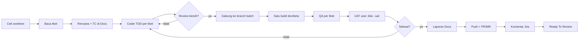

Kerjakan satu atau lebih tiket Jira (`$ARGUMENTS`). Sesi ini = **SPV**: ikuti `~/.claude/agents/spv.md` (tidak menulis kode produk, tidak memindah ke Done).

Baca dulu (jangan disalin ke sini): `~/.claude/skills/_agent-workflow-shared/rules.md`, `devices.md`, `credentials.md`, `build-release.md`, `report-format.md`, serta `~/.claude/agents/{coder,reviewer,qa,release}.md`. Skrip: `$AGENT_WORKFLOW_DIR/bin/<skrip>` (`AGENT_WORKFLOW_DIR` diisi seperti di `rules.md`). Setiap panggilan `device-lock.sh`/`device-pick.sh` diawali `AGENT_LOCK_PID=$PPID` di panggilan Bash yang sama.

**Alur** (`--batch` default; terpisah dari `--solo`/`--tim`, boleh digabung):
- **`--batch`:** semua tiket = satu batch: satu rencana, satu branch batch, **satu build**, QA di build itu. Proses berat jalan **sekali untuk semua tiket**, di titik tunggu langkah 7 dan 9. Tidak ada build, pasang, atau QA per tiket.
- **`--separate`:** tiap tiket jalur sendiri: rencana, build dev dari branch tiket, QA, laporan, dan selesai sendiri; tanpa branch batch. Build tetap antre `build:heavy`.
- **`--uat`:** sesudah QA lulus, user menguji sendiri build dev di HP fisik sementara SPV memantau log (langkah 8b). `--batch`: satu slot untuk build batch, owner `human-<KODE pertama>`; `--separate`: satu slot per tiket. Tanpa `--uat` tidak ada slot manusia.

## Langkah
0. **Guard:** kenali domain (`rules.md` → Workspace & worktree: `$ORCA_WORKTREE_ID`). Root project (`isMainWorktree: true`) atau tidak ketemu → berhenti: "Jalankan dari workspace domain". Tentukan checkout domain (git worktree workspace, atau `<repo>-<slug>` untuk workspace folder; tidak ada → buat sesuai `rules.md`), lalu kunci `checkout:<path>`. Branch batch (`--batch`) = branch checkout domain saat ini (hanya lokal, **tidak pernah** di-push ke upstream).
1. **Prasyarat (sekali):** Atlassian MCP terjangkau (`mcp__claude_ai_Atlassian__atlassianUserInfo`); `~/.agent-workflow/jira-transitions.json` punya entri project dengan id **Ready To Review** (belum → "Setup transisi Jira" di `rules.md`). Akun uji ada (`credentials.md`); tidak ada → berhenti & tanya.
2. **Baca tiket** + komentar + tiket terkait/blocking (`getJiraIssue`, `searchJiraIssuesUsingJql`). Catat per tiket: AC, platform (ios/android/api), dan apakah ter-link ke tiket `[release-request]`/`[hotfix-release]` (→ base & tujuan MR = branch rilis itu di `origin`; selain itu base `develop` atau sesuai `CLAUDE.md`). Tiket blocking belum selesai / requirement kabur → periksa dulu, lalu tanya. Cari spec API & kontrak Pact di repo; tidak ada → tanya; jawabannya jadi blok `## Catatan agen` untuk user (lihat `rules.md`).
3. **Rencana + test case** di Claude Docs (`mcp__claude_ai_Claude_Docs__batch`): `--batch`: satu dokumen untuk semua tiket; `--separate`: satu dokumen per tiket. TC per AC per tiket; TC yang butuh hardware asli ditandai `(fisik)` (`devices.md`). Tentukan mode dulu (kriteria langkah 4). **Tim:** SPV memanggil **Planner** (`planner.md`) dengan brief; Planner menulis dokumen `Rencana <KODE> — <judul singkat>` dan membalas link + ringkasan + status (Siap / Butuh jawaban / Tidak bisa); SPV memeriksanya terhadap device, antrean build, dan batch sebelum membagi tugas. Planner tidak tersedia atau **Tidak bisa** → SPV menulis sendiri dan mencatatnya di dokumen. **Solo**/tiket kecil: SPV menulis sendiri, catatan singkat cukup.
4. **Pilih mode** (`--solo`/`--tim` memaksa; tanpa flag → SPV menilai: 1 tiket kecil = solo, selain itu tim). Tiap tiket di **worktree tiket** `<repo>-<nomor>` sejajar checkout domain, branch `feature/|fix/|hotfix/|docs/|chore/<KODE>` dari `<base>` (`rules.md` → Workspace & worktree); tiket berbeda jalan paralel, tiap tiket MR sendiri. Tidak ada project/workspace Orca baru.
   - **Solo:** SPV sendiri menjalankan peran Coder → Reviewer (review diff sendiri dengan daftar cek `reviewer.md`, catat di laporan bahwa review bukan independen) → QA → Release, berurutan, sesuai file perannya.
   - **Tim:** tiap worker = **teammate** (tool Agent dengan `name: "<Nama>-<Label><n>"`, `subagent_type: <peran>`, `model` dari tabel); tampil sebagai panel split di tab SPV. Agen yang sama dipakai ulang lewat SendMessage, teammate yang tugasnya habis dihentikan; lengkapnya di `rules.md` → Orkestrasi. Teammate mode mati → tanya user (`rules.md`):
     | Peran | Model | Catatan |
     |---|---|---|
     | Planner | `claude-fable-5-2` (`model: "fable"`) | hanya-baca; dipanggil di langkah 3 dan saat eskalasi, dihentikan setelah membalas |
     | Coder | `claude-sonnet-5-5` | di worktree tiketnya; coder ke-2+ di tiket yang sama hanya bila file/modul terpisah, sebut batasnya di tugas |
     | Reviewer | `claude-opus-5-5` | bukan coder tiket itu; baca diff branch tiket |
     | QA (2-3) | `claude-sonnet-5-5` | uji build batch |
     | Release | `claude-haiku-5-5` | |
     Coder tidak boleh `git checkout` branch lain atau pindah ke worktree tiket lain; path worktree disebut di tugas. Tidak aman dibagi → cadangan solo (`rules.md`). Isi tugas: "Ikuti `~/.claude/agents/<peran>.md`", kode tiket, AC/TC, branch, batas file, jatah device/akun, folder laporan. Laporan worker datang lewat pesan teammate.
5. **Kode (TDD) → review:** Coder commit lokal di branch tiket (pesan menyebut KODE). Reviewer memeriksa performa/crash; temuan **wajib** (Critical/Important) → kembali ke Coder, review ulang sampai bersih. Lewat 2 putaran revisi (mode tim) → SPV memanggil Planner untuk analisis akar masalah + revisi rencana; rencana sudah direvisi 2 kali dan masih gagal → berhenti & tanya.
6. **Branch batch** (`--batch`; `--separate` lewati): di checkout domain, `git checkout <branch batch>` lalu `git merge --no-ff <branch tiket>` untuk tiap tiket yang lolos review. Konflik → berhenti dan tanya (sebut file dan tiketnya).
7. **Build (oleh Release):** kunci `build:heavy` dulu (owner `<KODE-pertama>-release1`), lepas sesudahnya; build antre satu per satu. Dipegang tiket Jira lain → tanya user tunggu atau dahulukan (`devices.md` → Build berat).
   - `--batch`: **titik tunggu.** Build hanya setelah **semua** tiket lolos review dan di-merge, atau dikeluarkan dari batch (alasan tertulis di rencana). Satu build dari branch batch. Jangan build saat sebagian tiket masih dikerjakan.
   - `--separate`: satu build per tiket dari worktree tiketnya, begitu tiket itu lolos review.
   - Dev selalu: nomor = `build-number.sh dev <KODE batch, atau satu KODE di --separate>`; semua KODE build itu di catatan rilis Firebase.
   - Beta: `build-number.sh next asc=… firebase=… tag=… project=…`; exit 3 → berhenti dan tanya.
   - Prod: hanya dengan izin eksplisit user, tidak pernah otomatis.
8. **QA per tiket** di build dev (`--batch`: build batch, **dipasang sekali per device** lalu semua tiket diuji di sana; `--separate`: build tiket itu), folder `${TMPDIR:-/tmp}/qa/<KODE>/`:
   - SPV membagi jatah: per QA run, **satu** `device-pick.sh <ios|android> <KODE>-qa<n>` per platform (platform disebut di tugas), dipakai untuk semua TC run itu; TC `(fisik)` dapat QA run sendiri dengan `--physical`; akun lewat `device-lock.sh acquire account:qa.userN <KODE>-qa<n>`.
   - UI → Maestro + screenshot bertanda (iOS native/metrik UI → XCUITest runner); API → Schemathesis (dev/staging); kontrak → Pact. Spec/kontrak tidak ada di repo → TC itu Tertahan + tanya.
   - QA menulis `report.md` + `*.png` sesuai "Laporan uji"; Gagal → kembali ke langkah 5. TC tidak bisa dijalankan / AC tidak teruji (mode tim) → SPV meminta Planner merevisi test case.
8b. **UAT (`--uat`)**, sesudah QA lulus dan sebelum langkah 10 (cara kerja slot: `devices.md` → Slot UAT):
   1. SPV menugaskan QA run `AGENT_LOCK_PID=$PPID "$AGENT_WORKFLOW_DIR/bin/device-pick.sh" <plat> <KODE>-qa<n> --physical`; QA memasang build dev yang diuji lalu lapor **tanpa melepas kunci**.
   2. SPV: `AGENT_LOCK_PID=$PPID "$AGENT_WORKFLOW_DIR/bin/device-lock.sh" move <res> <KODE>-qa<n> human-<KODE>`; beri tahu user di chat: device, app, build, dan "bilang *selesai UAT* bila sudah". `move` exit 1 (kunci QA hilang) → QA ambil ulang `--physical` dan pasang ulang build, lalu `move` lagi.
   3. SPV menjalankan `AGENT_LOCK_PID=$PPID "$AGENT_WORKFLOW_DIR/bin/uat-watch.sh" <res> <app> human-<KODE> ${TMPDIR:-/tmp}/qa/<KODE>/uat` di background (`run_in_background`).
   4. User bilang selesai → `AGENT_LOCK_PID=$PPID "$AGENT_WORKFLOW_DIR/bin/device-lock.sh" release <res> human-<KODE>` (watcher berhenti sendiri). Watcher `end=idle` (3 menit tanpa log) → slot sudah lepas sendiri. `end=released` tanpa user bilang selesai → slot diambil alih/dilepas lebih awal, UAT belum selesai: tanya user.
   5. `crash=0` → lanjut langkah 10. Crash → potongan `uat-crash.txt` masuk laporan uji dan tiket kembali ke langkah 5 (Coder → Reviewer → QA → UAT lagi).
   6. `uat-watch.sh` exit 3 (`end=error reason=…`, paket tidak ketemu atau proses log berhenti): beri tahu user bahwa pemantauan log gagal beserta alasannya; slot tetap `human-<KODE>` sampai user bilang selesai, dan hasil UAT bergantung pada laporan user.
9. **Putuskan selesai** (per tiket) hanya bila: semua TC AC **Lulus**, atau **Tertahan** dengan alasan tertulis; review tanpa temuan wajib; tes project lulus. Belum → ulangi 5–8 untuk tiket itu, dengan aturan:
   - `--batch`: **titik tunggu.** Perbaiki dan review semua tiket yang gagal dulu, merge ulang, lalu **satu** build ulang untuk batch; QA ulang tiket yang diperbaiki, tiket lain cukup cek singkat tidak rusak. Tidak ada build ulang per tiket.
   - Tiket macet (butuh jawaban, blocking) → keluarkan dari batch, laporkan statusnya, batch jalan terus tanpa tiket itu. Tidak dijalankan sendiri diam-diam.
   - `--separate`: ulangi hanya untuk tiket itu.
10. **Laporan:** SPV publikasikan laporan uji per tiket ke Claude Docs (`mcp__claude_ai_Claude_Docs__batch`, unggah screenshot). **Tunggu link dokumen kembali** sebelum lanjut; tanpa link → jangan komentar Jira.
11. **Push + PR/MR (Release):** `git push origin <branch tiket>` (hanya `origin`, branch batch tidak di-push). Tujuan: ter-link tiket rilis → branch rilis di downstream; selain itu → upstream base `develop`/`CLAUDE.md`. `gh pr create` bila host remote GitHub, `glab mr create` bila GitLab (cek `git remote get-url`). Judul berisi KODE; isi ringkasan, link laporan, nomor build.
12. **Komentar Jira** (`addCommentToJiraIssue`) per tiket: baris pertama link laporan, lalu link rencana, build dev/beta, PR/MR, ringkasan Lulus/Tertahan.
13. **Transisi** ke Ready To Review (`transitionJiraIssue`, id dari `jira-transitions.json`). Tidak pernah Done.
14. **Bersihkan & ringkas:** hapus worktree tiket buatan batch ini yang sudah Ready To Review (syarat di `rules.md`; tidak memenuhi → biarkan, sebut di ringkasan; tiket yang dikeluarkan dari batch tetap ditulis statusnya); hentikan semua teammate batch ini; pastikan semua kunci (device, akun, `build:heavy`, `checkout:*`) dilepas.

   | KODE | Status | Laporan | Build | PR/MR |
   |---|---|---|---|---|

## Berhenti lebih awal / galat
Sebelum berhenti (guard, tanya, galat, user membatalkan): lepas semua kunci milik batch ini (`AGENT_LOCK_PID=$PPID "$AGENT_WORKFLOW_DIR/bin/device-lock.sh" release <resource> <owner>` untuk tiap device (termasuk slot `human-<KODE>`), `checkout:*`, `account:*`, `build:heavy`), minta teammate melakukan hal sama lalu hentikan mereka, dan laporkan posisi terakhir per tiket. Pertanyaan wajib (`rules.md`): SPV tanya di chat dengan ringkasan + saran; teammate bertanya lewat SPV.
