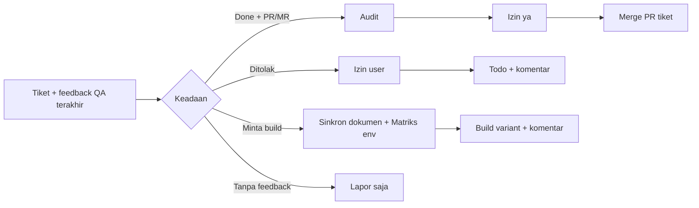

Tindak lanjuti feedback QA untuk satu atau lebih tiket (`$ARGUMENTS`). Sesi ini = **Release**: ikuti `~/.claude/agents/release.md`. Keputusan (izin Todo, izin merge, izin Prod) ke user lewat chat: ringkasan + satu saran. Rilis per versi (PR rilis, build live, tag) bukan di sini: itu `/branch-manager --rilis`.

Baca dulu (jangan disalin ke sini): `~/.claude/skills/_agent-workflow-shared/rules.md`, `build-release.md` (Merge PR tiket), `report-format.md`, `credentials.md`. Skrip: `$AGENT_WORKFLOW_DIR/bin/<skrip>` (`AGENT_WORKFLOW_DIR` diisi seperti di `rules.md`). Remote: `origin` = downstream (fork), `upstream` = repo utama.

## Langkah
0. **Prasyarat (sekali):** Atlassian MCP terjangkau (`mcp__claude_ai_Atlassian__atlassianUserInfo`); `~/.agent-workflow/jira-transitions.json` punya entri project dengan id **Todo** (belum → "Setup transisi Jira" di `rules.md`); `<primary>`/`<protected>` dan strategi merge PR tiket (squash atau merge commit) dari memory project (`rules.md` → Lokasi; belum ada → tanya, simpan). `git fetch upstream origin`.
1. **Per tiket, baca keadaan:** `getJiraIssue` + komentar (status Ready To Review/Done, tiket lain → lapor dan lewati), PR/MR-nya (`gh pr list --search <KODE>` / `glab mr list`) + komentar review. **Feedback QA terakhir** = komentar manusia terbaru (Jira + PR/MR) setelah komentar agen terakhir.
2. **Pilih tindakan:**
   | Keadaan | Tindakan |
   |---|---|
   | Ditolak QA | 3a |
   | Positif, belum Done, QA minta build variant lain (Beta/Prod) | 3b |
   | Done + punya PR/MR | 3c |
   | Positif tanpa permintaan build (belum Done) | Lapor saja, tanpa tindakan |
   | Tidak ada feedback QA | Lapor, tidak ada tindakan |

   Beberapa keadaan sekaligus → urutan **Done > ditolak > minta build**. Feedback saling bertentangan → tanya user, jangan menebak.
3. **Tindakan:**
   - **3a Ditolak:** ringkas arahan QA (apa yang ditolak, dari siapa, di mana). Minta izin user; "ya" → `transitionJiraIssue` ke **Todo** (id dari `jira-transitions.json`) + komentar ringkasan arahan (baris pertama link PR/MR bila ada). Putaran berikutnya lewat `/validate-tiket` (validasi ulang) lalu `/develop-tiket`. Tidak jawab ya → tidak ada perubahan.
   - **3b Minta build:**
     1. **Sinkron dokumen** sama persis dengan `/validate-tiket` langkah 1 (kontrak API, blueprint, mockup; catat ref).
     2. **Cek ulang Matriks env** untuk server tujuan (method aman saja, seperti `/develop-tiket` langkah 3; tanpa fuzzing, tanpa menulis data). Endpoint **Belum ada** / **Beda kontrak** di server tujuan → berhenti dan tanya.
     3. Pastikan isi tiket ada di build itu (branch/PR tiket; tidak ada → tanya). Build variant yang diminta di worktree tiket `<repo>-<nomor>` (sejajar checkout domain). Sudah dihapus → `git fetch origin`, lalu buat ulang sejajar checkout domain (`rules.md` → Workspace & worktree): branch lokal `<jenis>/<KODE>` sudah ada → worktree di branch itu (tanpa `-b`), lalu `git -C <worktree> merge --ff-only origin/<branch tiket>` (tidak bisa fast-forward → berhenti dan tanya); belum ada lokal → buat dengan `-b <jenis>/<KODE> origin/<branch tiket>`. Build (`build-release.md`: nomor build, upload; antre `build:heavy`); hapus lagi setelah build bila `git status --porcelain` kosong dan sudah di-push (tanpa `--force`). **Prod: izin eksplisit** dulu.
     4. Catatan rilis dan komentar Jira (baris pertama link laporan/build) menyebut **nama server + base URL API** build itu, tanpa kredensial.
   - **3c Done:** audit sesuai tabel `build-release.md` → Merge PR tiket (approved, CI hijau, diff sesuai tiket, Matriks env live **Sesuai kontrak**).
     - Cek PR revert: `gh pr list --repo <upstream> --state merged --head revert/<KODE>` / `glab mr list --merged --source-branch revert/<KODE>`. Ada (tiket pernah dikeluarkan dari rilis) → buat PR **revert dari revert** (branch `unrevert/<KODE>`; aturan di `build-release.md` → Rilis) dan merge setelah "ya"; baru PR tiket. Lewati langkah ini bila sudah ada PR merged dari `unrevert/<KODE>` yang lebih baru daripada PR merged `revert/<KODE>` (cek dengan `--head unrevert/<KODE>` / `--source-branch unrevert/<KODE>`).
     - Lolos → minta "ya" user, lalu merge: `gh pr merge <n> --repo <upstream> --squash|--merge` / `glab mr merge <n>`, strategi dari memory; belum tercatat → tanya, jangan menebak. Gagal satu syarat → lapor + saran, tidak merge. Komentar Jira (link PR + commit merge).
4. **Ringkasan** ke user:
   | KODE | Feedback | Tindakan | Build/PR | Status |
   |---|---|---|---|---|

Agen tidak pernah memindah tiket ke Done dan tidak pernah merge PR rilis ke `<primary>`.

## Berhenti lebih awal / galat
- Atlassian MCP atau `gh`/`glab` tidak terjangkau, id Todo belum ada → berhenti dan tanya.
- Build terhenti/dibatalkan → lepas kunci `build:heavy` (`release build:heavy <owner>`, `devices.md` → Build berat) sebelum lapor.
- Tidak ada yang di-merge atau dibuild tanpa jawaban "ya" yang diminta di atas.
