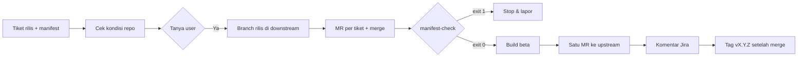

Jalankan satu rilis/hotfix (`$ARGUMENTS`). Sesi ini = **Release**: ikuti `~/.claude/agents/release.md`. Keputusan tingkat SPV (lanjut/berhenti, isi rilis) diserahkan ke user: di dalam run Orca lewat `orca orchestration gate-create --task <id> --question "<ringkasan + saran>" --options '["Ya","Tidak"]'`, di luar run lewat chat.

Baca dulu (jangan disalin ke sini): `~/.claude/skills/_agent-workflow-shared/rules.md`, `build-release.md`, `report-format.md`, `credentials.md`. Skrip: `$AGENT_WORKFLOW_DIR/bin/<skrip>` (`AGENT_WORKFLOW_DIR` diisi seperti di `rules.md`). Remote: `origin` = downstream (fork), `upstream` = repo utama.

## Langkah
0. **Guard:** `orca worktree current --json` harus berhasil (repo dikelola Orca). Primary maupun worktree domain boleh: langkah 0–4 hanya baca + Jira, perubahan file hanya di child worktree rilis (langkah 5). Di primary jangan edit file atau checkout branch lain. Prasyarat: Atlassian MCP terjangkau (`mcp__claude_ai_Atlassian__atlassianUserInfo`), `git remote -v` punya `origin` dan `upstream`.
1. **Tiket rilis:**
   - `baru release|hotfix` → tanya project, versi `vX.Y.Z`, dan daftar tiket fix/fitur. Buat tiket (`createJiraIssue`) berjudul `[release-request] vX.Y.Z …` / `[hotfix-release] vX.Y.Z …`, lalu link tiap tiket (`createIssueLink`). Catat KODE-RILIS.
   - `KODE-RILIS` → `getJiraIssue` + komentar. Judul harus diawali `[release-request]` (jenis **release**) atau `[hotfix-release]` (jenis **hotfix**); selain itu berhenti dan tanya.
   - Versi = `vX.Y.Z` pertama di judul; tidak ada → tanya.
   - **Manifest** = tiket yang ter-link ke tiket rilis (Atlassian MCP). Kosong → berhenti dan tanya.
2. **Hotfix sudah di-build?** Jika `hotfix/vX.Y.Z` sudah ada di `origin` dan komentar tiket rilis sudah mencatat build beta/prod → jangan tambah tiket. Manifest berbeda dari isi branch → berhenti, sarankan versi berikutnya (tiket rilis baru).
3. **Cek kondisi repo** (periksa dulu, `rules.md`): `git fetch --multiple origin upstream --tags`, lalu bandingkan
   - `upstream/master` vs `upstream/develop` (`git log --oneline A..B` dua arah) dan tag versi live terbaru (`git describe --tags --abbrev=0 upstream/master`);
   - fix lama yang ada di `master`/tag live tapi belum di-merge balik ke `develop`;
   - tiket manifest: `git branch -r --list 'origin/*/<KODE>'` harus tepat satu (tidak ada/lebih dari satu → berhenti dan tanya);
   - **hotfix**, per tiket: `git merge-base --is-ancestor <ref live> origin/<branch tiket>` sukses **dan** `git log --oneline --invert-grep --grep=<KODE> <ref live>..origin/<branch tiket>` kosong (semua commit menyebut KODE itu). Gagal → berhenti dan tanya, saran: cherry-pick commit tiket ke branch baru dari `<ref live>` (mencegah commit `develop` ikut ke hotfix);
   - **release**, per tiket: `git merge-base --is-ancestor origin/<branch tiket> upstream/develop` sukses → sudah termasuk, tidak perlu MR (sebut di ringkasan).
   Catat `<ref live>` (`upstream/master` atau tag live) untuk langkah 5 dan 7.
   Tulis ringkasan (tabel) + **satu saran** (base branch, versi, tiket yang belum siap).
4. **Selalu berhenti dan tanya** (juga di mode otonom): "Buat `<jenis>/vX.Y.Z` dari `<base>` dengan manifest …?" Tanpa "Ya" → berhenti. Jawaban + temuan diberikan ke user sebagai blok `## Catatan agen` untuk di-commit sendiri ke `CLAUDE.md` project (worktree primary diblokir guard, dan branch rilis tidak boleh memuat commit di luar manifest).
5. **Buat branch di downstream** (tidak pernah di upstream):
   - release: base `upstream/develop` (atau sesuai `CLAUDE.md`).
   - hotfix: base `<ref live>` (`upstream/master` atau tag live), **tidak pernah** `develop`.
   - `git push origin <base>^{commit}:refs/heads/<jenis>/vX.Y.Z` (`^{commit}` perlu untuk tag beranotasi), lalu child worktree: `orca worktree create --name <jenis>-vX.Y.Z --base-branch origin/<jenis>/vX.Y.Z --reference KODE-RILIS`.
6. **MR per tiket ke branch itu di downstream** (kecuali yang sudah termasuk di langkah 3; `git remote get-url origin` → GitHub/GitLab):
   - GitHub: `gh pr create --repo <fork-owner>/<repo> --base <jenis>/vX.Y.Z --head <branch tiket> --title "<KODE> …"`
   - GitLab: `glab mr create --repo <fork-ns>/<repo> --source-branch <branch tiket> --target-branch <jenis>/vX.Y.Z --title "<KODE> …"`
   Gabung di child worktree: `git merge --no-ff origin/<branch tiket>` per tiket. **Konflik** → `git merge --abort`, berhenti dan tanya (sebut file + dua tiket). Lalu `git push origin HEAD:<jenis>/vX.Y.Z` (nama branch lokal worktree bisa beda; MR otomatis tercatat merged).
7. **Cek manifest:** `$AGENT_WORKFLOW_DIR/bin/manifest-check.sh <ref live> origin/<jenis>/vX.Y.Z <KODE manifest...>` (`<ref live>` = ref yang sama dari langkah 3/5).
   - Exit 0 → lanjut. Exit 1 → berhenti, laporkan dua daftar dari skrip. Exit 2 → salah pakai/ref tidak ada: perbaiki perintah, jangan lanjut build.
8. **Build** (sesuai `build-release.md`, antre `build:heavy`): versi di file project harus `X.Y.Z` (beda → tanya). Nomor: `build-number.sh next asc=… firebase=… tag=… project=…`; exit 3 → berhenti dan tanya. Build beta → Firebase/TestFlight, catatan rilis berisi semua KODE manifest. **Prod hanya lewat gate/izin eksplisit**, tidak pernah otomatis.
9. **Satu MR ke upstream** dari branch rilis (base `master`, atau sesuai `CLAUDE.md`):
   - GitHub: `gh pr create --repo <upstream-owner>/<repo> --base master --head <fork-owner>:<jenis>/vX.Y.Z --title "[<prefix>] vX.Y.Z" --body "<manifest, build, link laporan>"`
   - GitLab: `glab mr create --repo <upstream-ns>/<repo> --head <fork-ns>/<repo> --source-branch <jenis>/vX.Y.Z --target-branch master --title "…"`
   Hanya satu MR per rilis; sudah ada → perbarui, jangan buat baru.
10. **Komentar tiket rilis** (`addCommentToJiraIssue`): bila ada laporan Claude Docs, baris pertama = link-nya; lalu manifest (tabel KODE → MR), nomor + link build beta, link MR upstream, hasil `manifest-check`. Tanpa kredensial. Tidak memindah ke Done.
11. **Tag versi** setelah MR upstream di-merge. Cek dulu: MR berstatus merged, versi di file project pada commit merge = `X.Y.Z`, dan tag `vX.Y.Z` belum ada di kedua remote. Lalu `git fetch upstream`, `git tag -a vX.Y.Z <commit merge> -m "<Platform> X.Y.Z (build) — <KODE manifest> (rilis KODE-RILIS)"`, `git push upstream vX.Y.Z`, `git push origin vX.Y.Z`. Belum di-merge → cukup ingatkan. Tag yang sudah ada tidak pernah ditimpa/dihapus; branch tetap tidak pernah di-push ke `upstream`.
12. **Ringkas:** pastikan kunci `build:heavy` dilepas; tabel `KODE | MR downstream | Status` + branch, build, MR upstream.

## Berhenti lebih awal / galat
Lepas kunci milik sesi ini (`AGENT_LOCK_PID=$PPID "$AGENT_WORKFLOW_DIR/bin/device-lock.sh" release build:heavy <owner>`), laporkan langkah terakhir, branch, dan MR yang sudah dibuat. Diblokir guard → laporkan pesannya, jangan cari jalan memutar.
