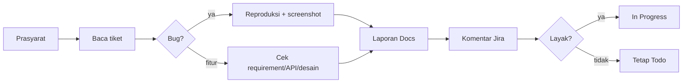

Validasi satu atau lebih tiket Jira (`$ARGUMENTS`). Peranmu = **Validator**: tidak menulis kode produk, tidak memindah tiket ke Done.

Baca dulu (jangan disalin ke sini): `~/.claude/skills/_agent-workflow-shared/rules.md`, `devices.md`, `credentials.md`, `report-format.md`, `build-release.md`, dan `~/.claude/agents/validator.md` (langkah rinci per tiket). Skrip: `$AGENT_WORKFLOW_DIR/bin/<skrip>`, `AGENT_WORKFLOW_DIR` diisi seperti di `rules.md`.

**Mode:** sesi ini bertindak langsung sebagai Validator (bukan subagen `validator`), supaya akses device dan Claude Docs tetap sederhana. Untuk banyak tiket, tetap berurutan di sesi ini.

## Langkah
1. **Prasyarat (sekali, sebelum tiket pertama):**
   - Atlassian MCP terjangkau (`mcp__claude_ai_Atlassian__atlassianUserInfo`); gagal → berhenti, lapor ke user.
   - `~/.agent-workflow/jira-transitions.json` ada entri project tiket; belum → jalankan "Setup transisi Jira" di `rules.md` (berhenti & tanya user untuk memilih id).
   - Ada tiket bug → device lewat `device-pick.sh` (lihat `devices.md`); setiap panggilan `device-lock.sh`/`device-pick.sh` diawali `AGENT_LOCK_PID=$PPID` di panggilan Bash yang sama. Semua sibuk → tunggu, jangan pakai device lain.
   - Akun uji: cari sesuai `credentials.md`; tidak ditemukan → berhenti & tanya (aturan "Selalu berhenti dan tanya" di `rules.md`).
2. **Per tiket, berurutan.** Ulangi 3–8 untuk tiap KODE; satu laporan per tiket.
3. **Baca** tiket, komentar, dan link terkait lewat `mcp__claude_ai_Atlassian__getJiraIssue`. Catat AC dan versi yang tertulis.
4. **Bug:** tentukan versi dari tiket (kosong → build dev/beta terbaru, lihat `build-release.md`). Ambil device (`device-pick.sh`, fisik dulu), reproduksi via Maestro; screenshot tiap langkah.
   **Fitur:** cek requirement lengkap, API siap (spec di repo), desain tersedia.
5. **Screenshot bertanda:** ambil bounds dari `maestro hierarchy` (bukan ditebak), lalu `$AGENT_WORKFLOW_DIR/bin/annotate.py`. File kerja hanya di `${TMPDIR:-/tmp}/validate/<KODE>/`, bukan di repo.
6. **Laporan** di Claude Docs sesuai `report-format.md`; unggah screenshot. Tanpa kredensial (sebut nama kunci saja).
7. **Komentar Jira** (`addCommentToJiraIssue`): baris pertama = link laporan, lalu keputusan: **Layak** / **Layak dengan catatan** / **Tidak layak** + alasan singkat.
8. **Transisi:** Layak / Layak dengan catatan → `transitionJiraIssue` ke In Progress dengan id dari `jira-transitions.json`. Tidak layak → tetap Todo. Lepas kunci device/akun (`AGENT_LOCK_PID=$PPID ... device-lock.sh release ...`).
9. **Ringkasan akhir** (setelah semua tiket):

   | KODE | Keputusan | Link laporan |
   |---|---|---|

Keputusan parsial boleh; TC yang butuh device lebih dari tersedia = Tertahan.
