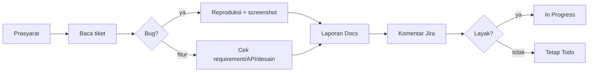

Validasi satu atau lebih tiket Jira (`$ARGUMENTS`). Peranmu = **Validator**; di mode tim kamu juga **SPV** (orchestrator). Tidak menulis kode produk, tidak memindah tiket ke Done.

Baca dulu (jangan disalin ke sini): `~/.claude/skills/_agent-workflow-shared/rules.md`, `devices.md`, `credentials.md`, `report-format.md`, `build-release.md`, dan `~/.claude/agents/validator.md` (langkah rinci per tiket); mode tim juga `~/.claude/agents/{pdm,product-designer,contract-runner,hoe,pjm,eskalasi}.md`. Skrip: `$AGENT_WORKFLOW_DIR/bin/<skrip>`, `AGENT_WORKFLOW_DIR` diisi seperti di `rules.md`.

**Mode:** sesi ini bertindak langsung sebagai Validator/SPV (bukan subagen `validator`), supaya akses Jira dan Claude Docs tetap di satu tempat. Tiket berurutan.
- `--solo` (atau tanpa flag untuk tiket kecil/jelas, satu platform): sesi ini mengerjakan semua langkah sendiri.
- `--tim` (tanpa flag: tiket fitur yang menyentuh bisnis + desain + API, atau bug lintas platform): langkah 4 dibagi ke teammate, lihat "Mode tim".

## Langkah
1. **Prasyarat (sekali, sebelum tiket pertama):**
   - Atlassian MCP terjangkau (`mcp__claude_ai_Atlassian__atlassianUserInfo`); gagal → berhenti, lapor ke user.
   - `~/.agent-workflow/jira-transitions.json` ada entri project tiket; belum → jalankan "Setup transisi Jira" di `rules.md` (berhenti & tanya user untuk memilih id).
   - Ada tiket bug → device lewat `device-pick.sh` (lihat `devices.md`); setiap panggilan `device-lock.sh`/`device-pick.sh` diawali `AGENT_LOCK_PID=$PPID` di panggilan Bash yang sama. Semua sibuk → tunggu, jangan pakai device lain.
   - Akun uji: cari sesuai `credentials.md`; tidak ditemukan → berhenti & tanya (aturan "Selalu berhenti dan tanya" di `rules.md`).
   - **Sinkron sumber (sekali per sesi):** lokasi dokumen business discovery, desain/mockup, kontrak API, blueprint dari memory project (`rules.md` → Lokasi; belum ada → tanya user, simpan). Repo yang sama dengan kode → `git fetch upstream` lalu baca dari `upstream/<protected>` (branch project dari memory, `rules.md` → Lokasi) tanpa checkout; repo dokumen terpisah → `git pull` di checkout dokumen itu (bukan worktree primary). Lalu `graphify update` bila project memakai graphify. Catat ref yang dibaca di laporan.
2. **Per tiket, berurutan.** Ulangi 3–8 untuk tiap KODE; satu laporan per tiket.
3. **Baca** tiket, komentar, dan link terkait lewat `mcp__claude_ai_Atlassian__getJiraIssue`. Catat AC dan versi yang tertulis.
4. **Bug:** tentukan versi dari tiket (kosong → build dev/beta terbaru, lihat `build-release.md`). Ambil device (`device-pick.sh`: virtual dulu; `--physical` bila butuh hardware asli, lihat `devices.md`), reproduksi via Maestro (cadangan per platform di `devices.md`); screenshot tiap langkah.
   **Fitur:** cek requirement lengkap, API siap (spec di repo), desain tersedia.
   **Tiket terkait (solo dan tim):** selain link yang ada, cari tiket Todo/In Progress yang tidak di-link tapi menyentuh komponen/label/layar/fitur/endpoint yang sama (JQL `text ~`); mode tim dikerjakan PjM. Link antar tiket tidak dibuat sendiri: cukup disarankan di komentar.
   **Aturan keputusan** (temuan PdM/PjM/HoE atau pemeriksaanmu sendiri):
   | Kondisi | Keputusan | Tindakan |
   |---|---|---|
   | Informasi minim, AC inti jelas | Layak dengan catatan | Pertanyaan di komentar Jira untuk reporter |
   | Informasi minim, AC inti kabur | Tidak layak | Tetap Todo; komentar berisi daftar yang harus dilengkapi |
   | Bertabrakan dengan tiket/dokumen lain | Tidak layak sampai diputuskan | Komentar menyebut kedua tiket + titik tabrakan (kutipan); tanya user mana yang berlaku |
   | Tumpang tindih tapi selaras | Layak dengan catatan | Saran urutan pengerjaan atau penggabungan |
5. **Screenshot bertanda:** ambil bounds dari `maestro hierarchy` atau `-frames.json` XCUITest (bukan ditebak), lalu `$AGENT_WORKFLOW_DIR/bin/annotate.py`. File kerja hanya di `${TMPDIR:-/tmp}/validate/<KODE>/`, bukan di repo.
6. **Laporan** di Claude Docs sesuai `report-format.md`; unggah screenshot. Tanpa kredensial (sebut nama kunci saja).
7. **Komentar Jira** (`addCommentToJiraIssue`): baris pertama = link laporan, lalu keputusan: **Layak** / **Layak dengan catatan** / **Tidak layak** + alasan singkat.
8. **Transisi:** Layak / Layak dengan catatan → `transitionJiraIssue` ke In Progress dengan id dari `jira-transitions.json`. Tidak layak → tetap Todo. Lepas kunci device/akun (`AGENT_LOCK_PID=$PPID ... device-lock.sh release ...`).
9. **Mode tim** (menggantikan langkah 4–5, SPV tetap menulis laporan, komentar, transisi):
   - Panggil teammate paralel (tool Agent, `name` dari tabel "Nama agen" di `rules.md`, `subagent_type` = peran, `model` dari tabel): PdM, Product Designer (tiket UI/bug UI), Contract Runner (tiket menyentuh API), HoE, PjM.
     | Peran | Model | Catatan |
     |---|---|---|
     | PdM | `claude-sonnet-5-5` | dokumen business discovery |
     | Product Designer | `claude-sonnet-5-5`; eskalasi `claude-opus-5-5` | tiket UI/bug UI |
     | Contract Runner | `claude-sonnet-5-5` | tiket yang menyentuh API; hasil diteruskan ke HoE |
     | HoE | `claude-opus-5-5` | selalu di mode tim |
     | PjM | `claude-sonnet-5-5` | selalu di mode tim |
     | Spesialis eskalasi | `claude-fable-5-2` (jangan isi `model`: frontmatter yang berlaku) | hanya saat pemicu; dihentikan setelah membalas | Brief: KODE, ringkasan tiket + AC, lokasi dokumen + ref, worktree/repo, jatah device/akun (bug), folder `${TMPDIR:-/tmp}/validate/<KODE>/`. Prompt: "Ikuti `~/.claude/agents/<peran>.md`".
   - Hasil Contract Runner diteruskan ke HoE. Bug UI → Product Designer reproduksi; bug logika/API → HoE.
   - **Eskalasi Product Designer ke opus:** reproduksi bug UI gagal/rumit setelah satu putaran → panggil ulang dengan `model: claude-opus-5-5`.
   - **Spesialis eskalasi (`eskalasi`, fable) hanya bila:** bug logika gagal direproduksi HoE setelah satu putaran; temuan HoE ambigu (bug atau disengaja); tiket berlabel high-risk (pembayaran, autentikasi, perubahan skema data); konflik antar-agen yang tidak bisa kamu selesaikan. Sebut pemicunya di brief.
   - Gabungkan semua `${TMPDIR:-/tmp}/validate/<KODE>/*.md` jadi satu laporan (`report-format.md` → bagian Bisnis / Desain / Teknis / Ketergantungan). Tiket UI tanpa mockup → paling tinggi **Layak dengan catatan**. Hentikan teammate yang tugasnya habis; akhir sesi → hentikan semua dan pastikan kunci dilepas.
10. **Ringkasan akhir** (setelah semua tiket):

   | KODE | Keputusan | Link laporan |
   |---|---|---|

Keputusan parsial boleh; TC yang butuh device lebih dari tersedia = Tertahan.
